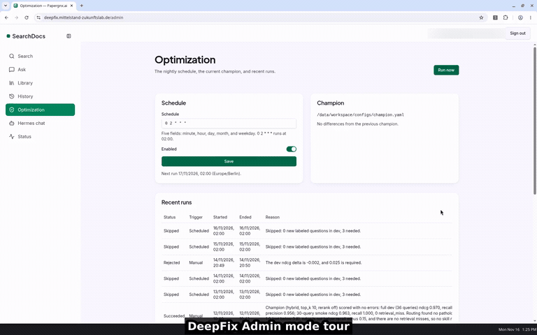
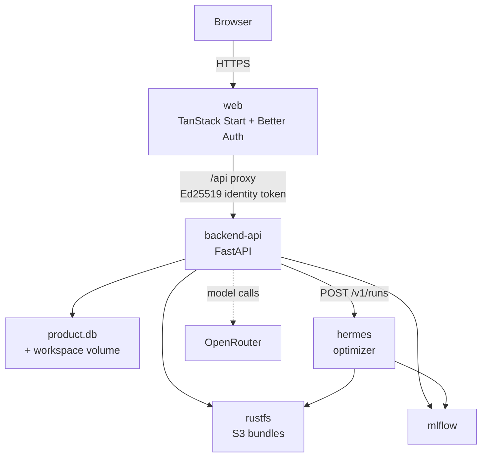
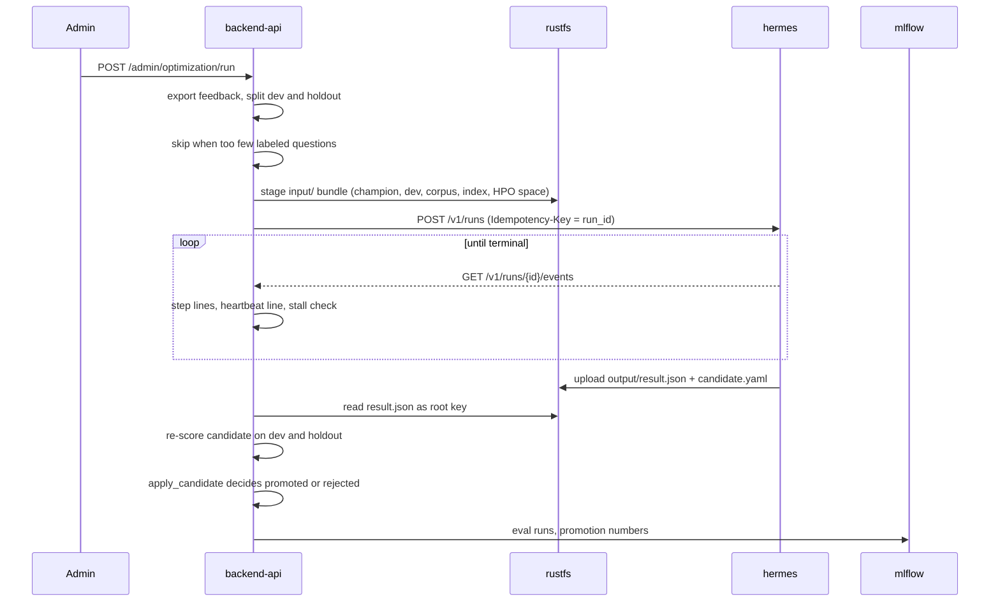

# DeepFix

DeepFix answers questions over a company's own documents and keeps getting better at finding them. It is a RAG system for German SMEs built on [LlamaIndex](https://www.llamaindex.ai/) with a [LanceDB](https://lancedb.com/) vector store on [RustFS](https://rustfs.com/), wrapped in a product people can sign in to, plus an optimizer that tunes retrieval on their own feedback.

[](docs/media/deepfix-admin-tour.mp4)

The clip above is a 2 fps sample of the [104-second recording](docs/media/deepfix-admin-tour.mp4), every frame of which is captioned. GitHub does not play a committed MP4 inline, so that link downloads the file for your own player; the chapter list, the subtitle file, and the written guide sit in [Admin mode tour](#admin-mode-tour) below.

The pipeline is deterministic: chunking, dense/BM25/hybrid retrieval, optional reranking, and synthesis are configured by one validated YAML file. Around it sit three things that are kept deliberately separate:

1. **The `deepfix` CLI** — `dataset`, `index`, `eval`, `gate`, `hpo`, `mutate-config`, `diff-config`, `schema`, `run-diagnostic`. Scriptable, JSON on stdout, fixed exit codes.
2. **Agent skills** — twelve `SKILL.md` procedures an agent reads to diagnose one failure mode and run one remediation round.
3. **A product stack** — a FastAPI service, a TanStack Start web app with accounts and an admin section, a Hermes sandbox that runs optimization rounds, MLflow for lineage, and RustFS for indexes and run bundles.

The optimizer is **Hermes**: one sandboxed agent run per round, inside a 40-turn budget, testing one hypothesis. Hermes proposes; `backend-api` scores holdout and decides.

Developed by **Mittelstand Zukunftslab & AI Service Center (AISC) HPI**.

---

## What you get

| Feature | What it does |
| :--- | :--- |
| **Search** | Dense, BM25, or hybrid retrieval over a shared corpus, with optional reranking and a relevance floor once reranking is on. |
| **Ask** | A chat over the same corpus. Answers cite the passages they came from, each passage stays votable, and a grounding badge says whether the answer is backed by the corpus. [Streaming, multi-turn Ask chat is coming with PR #23](https://github.com/Mittelstand-Zukunftslab/deepfix-rag/pull/23). |
| **Library** | Upload text, Markdown, and PDF files (20 MB each) into the shared workspace corpus. |
| **History** | Every search and question from the team, with the answer returned, the passages shown, and the votes given. Filterable by person, type, and feedback. |
| **Optimization** | The nightly schedule, the current champion config and its diff, recent runs with their dev and holdout deltas, and *Run now*. |
| **Hermes chat** | An admin-only assistant that reads this server's schedule, champion, and runs, and can propose a run as an action card. Nothing starts until an admin confirms it. |
| **`deepfix` CLI** | The same domain layer, scriptable: ingest, index, score, gate, sweep hyperparameters, mutate a config. |

Accounts and roles live in the web app (Better Auth, `member` and `admin`). Admin pages and admin routes refuse a member with 403, in the UI and again in the API.

---

## Admin mode tour

A 104-second recording of the live admin experience: Ask, Optimization, History, and the Hermes chat, in that order. Captions are burned in at the bottom, and the same cues ship as a subtitle file.

**[Watch the full recording (MP4, 104 s)](docs/media/deepfix-admin-tour.mp4)** · **[Preview GIF](docs/media/deepfix-admin-tour-preview.gif)** · **[Subtitles](docs/media/deepfix-admin-tour.srt)**

The preview at the top of this page is the same recording sampled at 2 fps and scaled to 768 px wide, so it loads as an image everywhere; the MP4 is the readable copy, with the full frame and the captions at their original size.

| Time | Segment |
| --- | :--- |
| 00:00.0 | DeepFix Admin mode tour |
| 00:02.5 | Ask chat: ask a question in a new thread |
| 00:15.0 | Answers stream in with citations, sources and a grounding badge |
| 00:31.5 | Optimization: nightly schedule, current champion config and recent runs |
| 00:41.5 | History: every search and answer, with passages shown and feedback |
| 00:59.0 | History filter: only interactions that received feedback |
| 01:07.0 | Admin chat: talk to Hermes, the optimization agent |
| 01:19.0 | Hermes summarizes runs; any action it proposes waits for your Confirm |
| 01:35.5 | Back on the Optimization page |

The recording was made from a stack running the Ask chat from PR #23, so that segment shows the streaming, multi-turn chat described below. [`docs/admin-mode.md`](docs/admin-mode.md) is the written guide to the same features, with stills taken from this recording.

---

## Architecture



Only `web` is reachable from a browser. It signs the user in with Better Auth, then proxies every other `/api/*` call to `backend-api` with a short-lived Ed25519 identity token, so the API trusts the web app's session without holding a cookie itself.

`backend-api` owns the state: SQLite `product.db`, the workspace volume that holds the corpus, the indexes, `configs/champion.yaml`, and `runs/`, plus the object store and the tracker. It starts a round by posting to `hermes` and then polls the gateway's event stream, so the sandbox never holds the promotion decision. `hermes` writes its run bundle and its spans to `rustfs` and `mlflow` under keys scoped to `optimization/runs/*`, and both it and the API call OpenRouter for generation, judging, embeddings, and rerank.

| Service | Role | Host port |
| :--- | :--- | :--- |
| `web` (container `deepfix-web`) | TanStack Start app on 8080. Owns sign-in and sessions with Better Auth; proxies every other `/api/*` call to FastAPI with a short-lived identity token. Admin section at `/admin`. | none; Traefik proxies to `8080` |
| `backend-api` (container `deepfix-api`) | FastAPI product API on 8000: documents, index, retrieval, ask, feedback, history, the optimization job API, the admin Hermes chat routes, and the scheduler. One uvicorn worker, because SQLite, the index writer, and the APScheduler instance assume one process. | none; Traefik proxies to `8000` |
| `hermes` | The optimization sandbox. Its API server takes one run at a time and streams step events. A second, standalone chat profile can be started on `8643`. No Docker socket, no dashboard. | none |
| `mlflow` | Experiment tracking and the trace sink for `eval` and for the Hermes agent. It has no authentication of its own, so a Traefik router with a basic-auth middleware is the only way in. | none |
| `rustfs` | S3-compatible object store: the index cache and the per-run bundles under `optimization/runs/<run_id>/`. | none |
| `diagnostic-agent` | Optional DeepFix analysis server (`deepfix-server`), used only by `deepfix run-diagnostic`. | 8844 |
| `memgraph`, `falkordb` | Optional graph stores for the manual `graph` backend, from `compose.graphdb.yml`. The promotion gate rejects `graph` and `mixed`. | 7687, 6379 |

`docker-compose.yml` includes `compose.hermes.yml`, which defines `hermes`, and `compose.graphdb.yml`, which defines the two graph stores. Drop the graph include where graph retrieval is not used.

### Models

Every model id is deployment configuration read from the environment. No model id has a default in the package: an empty value fails at the point of use and names the variable.

| Purpose | Variable | Default in `example.env` |
| :--- | :--- | :--- |
| Answer generation and query expansion | `LLM_MODEL` | `qwen/qwen3.8-flash` |
| DeepEval judge | `LLM_JUDGE_MODEL` | `z-ai/glm-5.3-flash` |
| Hermes optimization agent | `HERMES_MODEL` | `deepseek/deepseek-v4.1-flash-1017` |
| Admin chat | `HERMES_CHAT_MODEL` | unset, falls back to `HERMES_MODEL` |
| Embeddings | `EMBEDDING_MODEL` | `perplexity/pplx-embed-v1-4b` |
| Reranker | `COHERE_MODEL` | `cohere/rerank-4-fast` |

Each row is read from the environment and reaches its own endpoint, so the endpoint is a variable rather than a column: generation and the judge use `LLM_BASE_URL`, embeddings use `EMBEDDING_BASE_URL`, the reranker posts to `<COHERE_BASE_URL>/rerank`, and `HERMES_MODEL_BASE_URL` is an optional override for the agent (unset means OpenRouter).

`embedding.model`, `rerank.model`, and `generation.model` are not config keys; `deepfix mutate-config` rejects them. The reranker is DeepFix's own HTTP client for OpenRouter's rerank API, authorized by `OPENROUTER_API_KEY`; the native Cohere `/v2/rerank` path is never called, and `COHERE_API_KEY` is only a fallback the client reads when `OPENROUTER_API_KEY` is empty. `rerank.min_relevance_score` (default `0.3`) is the relevance floor applied while reranking is on: a passage below it is dropped before generation and before display. With rerank off nothing is filtered by score, because the retriever's own scale is different.

### Repository layout

- `.agents/skills/` — the twelve agent skills; `optimization-loop/` is the entry point.
- `configs/` — RAG and HPO configuration, described in `configs/README.md`.
- `docker/hermes/` — sandbox image, boot script, CLI shim, run-tag plugin.
- `docs/` — admin guide, deployment notes, runbooks, and the tour media.
- `plugins/deepfix-rag/` — plugin manifest: the twelve skills and their aliases.
- `src/deepfix_rag/` — the domain layer: `pipeline.py` (the LlamaIndex Workflow),
  `indexing.py` (blue-green builds), `promotion.py` (scores, gate, champion),
  `optimization.py` (run rows, Hermes supervision), `optimization_schedule.py`,
  `admin_chat.py`, `data.py`, `documents.py`, `feedback.py`, `run_bundle.py`.
  - `api/` — FastAPI app, routes, schemas, identity, chat relay.
  - `cli/` — Typer subcommands and the exit-code helpers.
  - `config/` — Pydantic schema, settings, mutator, HPO space.
  - `diagnostics/` — failure-analysis client for `deepfix-server`.
  - `evaluation/` — DeepEval runner, judge, MLflow tracker.
- `tasks/` — PRDs, stories, plans, and implementation notes.
- `tests/` — pytest suite; markers are registered in `pyproject.toml`.
- `web/` — the TanStack Start product UI (Bun, TypeScript).
- `compose.hermes.yml` — the `hermes` service.
- `compose.graphdb.yml` — optional `memgraph` and `falkordb` services.
- `docker-compose.yml` — `web`, `backend-api`, `mlflow`, `rustfs`, `diagnostic-agent`.
- `example.env` — environment template; copy it to `.env`.

---

## Quick start

Two paths. **Path A** runs the product stack in Docker and needs nothing but Docker. **Path B** runs the API and the web app from source, for working on the code. Both start from a fresh clone of `main`.

Prerequisites for either path:

- Docker Engine with Compose v2 (`docker compose version`).
- `git`.
- For Path B: **Python 3.12**, [uv](https://docs.astral.sh/uv/), and **Bun**.
- **Node 22.20+** only if you want `npx` to install the skills.
- A JDK is optional: `pyterrier`'s `pt.Evaluate` path, which DeepFix uses, runs without a JVM.

```bash
git clone https://github.com/Mittelstand-Zukunftslab/deepfix-rag.git
cd deepfix-rag
cp example.env .env
```

### The four keys to set before the first start

Three of these block Compose outright: it interpolates every service, so a missing value fails even when you start only `web`. The fourth, `BETTER_AUTH_SECRET`, lets the stack start but makes every sign-in fail. `example.env` ships all four empty.

| Key | Why it must be set | Generate |
| :--- | :--- | :--- |
| `API_SERVER_KEY` | Bearer between the API and Hermes. At least 16 characters; placeholders are rejected. | `openssl rand -hex 32` |
| `HERMES_S3_ACCESS_KEY_ID` | The `hermes-optimizer` key. The sandbox refuses a root key or a placeholder. | any non-placeholder value locally |
| `HERMES_S3_SECRET_ACCESS_KEY` | Matching secret for the above. | any non-placeholder value locally |
| `BETTER_AUTH_SECRET` | Better Auth signing secret. Empty makes every `/api/auth/*` call answer 500. Set it once and keep it: changing it invalidates existing sessions. | `openssl rand -base64 32` |

Fill them in place:

```bash
sed -i.bak \
  -e "s|^API_SERVER_KEY=.*|API_SERVER_KEY=$(openssl rand -hex 32)|" \
  -e "s|^HERMES_S3_ACCESS_KEY_ID=.*|HERMES_S3_ACCESS_KEY_ID=local-dev-hermes-key|" \
  -e "s|^HERMES_S3_SECRET_ACCESS_KEY=.*|HERMES_S3_SECRET_ACCESS_KEY=local-dev-hermes-secret|" \
  -e "s|^BETTER_AUTH_SECRET=.*|BETTER_AUTH_SECRET=$(openssl rand -base64 32)|" \
  .env && rm .env.bak
```

To get real answers rather than configuration errors, also set the model keys you have: `LLM_API_KEY` and `EMBEDDING_API_KEY` (OpenRouter by default, per `LLM_BASE_URL` and `EMBEDDING_BASE_URL`), and `OPENROUTER_API_KEY` for reranking and the sandbox. `example.env` carries the model ids. Model ids are deployment configuration: an empty one fails at the point of use and names the variable. `MLFLOW_BASIC_AUTH_USERS` is only needed by the MLflow router, and empty fails closed.

### Path A: the full stack in Compose

The Compose file publishes no host port for `web`, `backend-api`, `mlflow`, or `rustfs`: in a deployment, Traefik routes to them. Locally, two things are needed — the external network the `mlflow` router joins, and a loopback-only port so a browser can reach the app:

```bash
docker network create dokploy-network   # once, on any host that is not Dokploy

cat > docker-compose.local.yml <<'YAML'
services:
  web:
    ports: ["127.0.0.1:8080:8080"]
  backend-api:
    ports: ["127.0.0.1:8000:8000"]
  mlflow:
    ports: ["127.0.0.1:5000:5000"]
YAML

docker compose -f docker-compose.yml -f docker-compose.local.yml up -d --build
```

Keep that file out of git; loopback-only, never a bare `8080:8080`. Then:

| What | Where | Notes |
| :--- | :--- | :--- |
| Web app | <http://localhost:8080> | Sign in at `/sign-in`, register at `/register`. The admin section is `/admin`. |
| API | <http://localhost:8000/health>, docs at `/docs` | The browser normally reaches it through the web app's `/api/*` proxy. |
| MLflow | <http://localhost:5000> | UI and tracking API. No basic auth locally unless you set a router host. |
| Hermes | none | Internal on `8642`. Check it with `docker compose exec backend-api curl -s http://hermes:8642/health`. |

The first admin is created from an account, because registration only ever creates `member` and the Compose stack keeps its users in the `web_auth` volume rather than in `~/.deepfix`:

```bash
# 1. Register any account at http://localhost:8080/register, then promote it:
EMAIL=you@example.com
docker compose -f docker-compose.yml -f docker-compose.local.yml exec -w /app/.output/server web \
  node -e "const D=require('better-sqlite3');const db=new D('/data/auth.db');const r=db.prepare('update user set role=? where email=?').run('admin',process.argv[1]);console.log(r.changes?'promoted':'no such user')" "$EMAIL"
```

Sign out and back in after promoting, so the browser holds a token that says `admin`. Then leave `BETTER_AUTH_SECRET` alone: changing it while accounts exist breaks token minting for those sessions. (`web/scripts/create-admin.ts` writes the dev-server database `~/.deepfix/web/auth.db`; it does not reach the Compose volume.)

Stop it, keeping your data and index:

```bash
docker compose -f docker-compose.yml -f docker-compose.local.yml down
# add -v to delete the volumes too: auth users, product.db, the index, MLflow runs
```

Plain `docker compose up -d` also starts the optional `diagnostic-agent` (publishing `8844`) and the `memgraph` / `falkordb` graph stores (`7687`, `6379`), which pull several GB and collide with anything already on those ports. Name the five core services instead when you do not need them:

```bash
docker compose -f docker-compose.yml -f docker-compose.local.yml up -d --build \
  rustfs mlflow backend-api hermes web
```

Index builds and search stay inside the `api_data` workspace volume. RustFS holds optimization run bundles and serves an `S3_URI` index when one is copied from `s3://`, so a local index and search do not need a bucket or any object-store setup.

### Path B: the dev servers

Run the API and the web app from source. The Compose stack cannot do this for you locally, because it publishes no host ports.

```bash
uv sync                      # creates .venv from uv.lock
source .venv/bin/activate

uv run --env-file .env uvicorn deepfix_rag.api.app:app --reload --port 8000
```

The API needs no other setup: `GET /health` answers, and its first start seeds `configs/champion.yaml` and an empty product database under `~/.deepfix/`.

In a second shell:

```bash
cd web
cp .env.example .env.local               # then set BETTER_AUTH_SECRET, same value as in .env
bun install
bun run dev                              # http://localhost:8080
```

`WEB_ORIGIN` in `.env` must equal `BETTER_AUTH_URL` in `web/.env.local` — it is the identity token's issuer and audience — and the API fetches the signing keys from `WEB_ORIGIN/api/auth/jwks`. `web/.env.example` already points `API_INTERNAL_URL` at the API on port 8000.

The first admin here is one command, because `bun run dev` reads the same SQLite file the script writes. The password is read from stdin:

```bash
cd web && bun run auth:create-admin --email admin@example.com
```

### Troubleshooting

| Symptom | Cause and fix |
| :--- | :--- |
| `network dokploy-network declared as external, but could not be found` | Run `docker network create dokploy-network` once. |
| `required variable API_SERVER_KEY is missing a value` (or `HERMES_S3_*`) | Compose interpolates every service, even one you are not starting. Set the [four keys](#the-four-keys-to-set-before-the-first-start). |
| Web app loads but every sign-in answers 500 `Sign-in is unavailable.` | `BETTER_AUTH_SECRET` is empty. Set it and `docker compose up -d web` again, or restart `bun run dev`. |
| MLflow answers 403 `Invalid Host header - possible DNS rebinding attack detected` | MLflow 3.x matches `Host` exactly, and `127.0.0.1:5000` plus `localhost:5000` are already in `MLFLOW_SERVER_ALLOWED_HOSTS`. If you mapped a different port, add that `host:port` to the list in `.env` and recreate `mlflow`. |
| MLflow login rejects every password (only when MLflow is reached through Traefik) | The bcrypt hash was not `$`-doubled. Generate with `htpasswd -nbB admin 'pass' \| sed -e 's/\$/\$\$/g'` and paste the output as-is. Compose re-interpolates it, so a single-`$` hash is corrupted. |
| Admin pages still refuse the account you just promoted | The browser holds a session issued before the promotion. Sign out at `/sign-in` and back in. |
| Sign-in works, then every `/api/*` call answers 502 `The API is unavailable.` | `BETTER_AUTH_SECRET` was changed while accounts already existed; existing sessions can no longer mint an identity token, and Better Auth answers 500 on `/api/auth/token`. Keep the secret stable, or reset the auth volume with `docker compose … down -v` and register again. |
| Index rebuild fails with `Missing credentials … OPENAI_API_KEY` or `Invalid API key: this is not an OpenRouter API key` | `EMBEDDING_API_KEY` is empty or is not a key for `EMBEDDING_BASE_URL`. Set it, and `LLM_API_KEY` for search answers, then rebuild the index. |
| `deepfix eval` fails with `error_type: stale_index` and `Could not resolve host: rustfs` | A host-run CLI cannot resolve Compose names. Pass a real `--index-dir`, or run the command inside the stack. |
| Traefik hosts are `*.invalid` | Intentional fail-closed default: `DEEPFIX_WEB_HOST`, `DEEPFIX_API_HOST`, and `MLFLOW_PUBLIC_HOST` are unset. Set them only for a real deployment; locally use the port override above. |
| Port `8844`, `7687`, or `6379` already in use | The optional `diagnostic-agent` or graph stores are already running elsewhere. Start the five core services by name. |

### Install the CLI and the skills

The package is not on PyPI:

```bash
uv tool install "git+https://github.com/Mittelstand-Zukunftslab/deepfix-rag.git"
deepfix --help            # also installs deepfix-rag and deepfix-sync

npx skills add Mittelstand-Zukunftslab/deepfix-rag -y    # the twelve skills into your agent
```

### One round by hand

```bash
deepfix dataset load --name bundestag-qa --split train
deepfix index --config configs/default.yaml \
  --dataset data/processed/bundestag-qa/train/corpus.jsonl \
  --index-dir data/indexes/bundestag_train --force
deepfix eval --config configs/default.yaml \
  --dataset data/processed/bundestag-qa/train/qa.jsonl \
  --index-dir data/indexes/bundestag_train --limit 20

deepfix mutate-config --base configs/default.yaml \
  --set rerank.enabled=true --set rerank.top_n=5 --set retrieval.top_k=20 \
  --output /tmp/candidate_v1.yaml

deepfix eval --config /tmp/candidate_v1.yaml --compare configs/default.yaml \
  --dataset data/processed/bundestag-qa/train/qa.jsonl \
  --index-dir data/indexes/bundestag_train \
  --baseline-index-dir data/indexes/bundestag_train \
  --limit 20 --json > /tmp/compare.json
deepfix gate --compare /tmp/compare.json --primary ndcg --json
```

`eval` never builds an index: a missing `--index-dir` is filled from the config's own `s3://` index, and a local config with no index fails with `error_type` `stale_index` rather than silently scoring a fresh one. `gate` passes only when the paired primary delta clears `OPTIMIZATION_MIN_PRIMARY_DELTA`, the bootstrap interval lies above zero, no higher-is-better metric falls past `OPTIMIZATION_SECONDARY_TOLERANCE`, both sides scored every case, and neither side silently changed backend.

### CLI reference

Every subcommand accepts `--json`: the payload goes to stdout, logs and progress to stderr. Exit codes are `0` success, `1` validation error, `2` runtime error. `deepfix export` and `deepfix dataset generate-unanswerable` are declared but not implemented and always exit 2.

| Command | What it does |
| :--- | :--- |
| `deepfix dataset load` | `--name <preset_or_hf_repo> [--split train] [--limit N] [--subset corpus\|qa] [--corpus-only] [--data-root <dir>]` |
| `deepfix dataset list` | Lists locally ingested datasets and their split directories. |
| `deepfix index` | `--config <yaml> [--dataset <corpus>] [--index-dir <dir_or_s3_uri>] [--force] [--if-changed]` |
| `deepfix eval` | `--config <yaml> [--compare <yaml>] [--index-dir] [--baseline-index-dir] [--limit N] [--retrieval-only] [--max-error-rate F] [--seed N] [--no-mlflow]` |
| `deepfix gate` | `--compare <compare.json> [--primary ndcg\|recall\|precision\|<generation metric>] [--min-delta F] [--secondary-tolerance F]` |
| `deepfix mutate-config` | `--base <yaml> --set key.sub=value [--set ...] --output <yaml>` |
| `deepfix diff-config` | `[config_a] [config_b]` or `--base <yaml> --compare <yaml>` |
| `deepfix hpo` | `[--n-trials N] [--timeout S] [--run-dir <dir>] [--index-dir <dir>] [--retrieval-only] [--tune-chunking]` |
| `deepfix schema` | Prints the schema version, the index-time keys, and the top-level fields. |
| `deepfix run-diagnostic` | `[--dataset <d>] [--config <yaml>] [--server-url <url>] [--limit N]`. Needs a reachable analysis server. |

`--retrieval-only` scores nDCG, recall, and precision and calls neither the generation model nor the judge. `--seed` with `--limit` draws a deterministic sample instead of taking the first rows. `deepfix hpo` defaults to `--config configs/hpo.yaml`; `configs/hpo_retrieval_small.yaml` is the shipped query-time space an optimization round uses — twelve trials on 20 seeded questions over `top_k` 10/20/50, rerank off or on with `top_n` 5 or 10, query expansion 1 to 3, and fusion modes `reciprocal_rerank`, `relative_score`, and `dist_based_score` (with dense weights 0.3/0.5/0.7 under the two that read them). `simple` and every chunking key are out of the space on purpose. A pruned duplicate parameter set does not shorten the budget, and a trial in which every case errored is recorded `FAIL` rather than scored `0.0`.

---

## Configuration

### Pipeline config

`configs/default.yaml` is the baseline the API seeds into a fresh workspace as `champion.yaml`. `src/deepfix_rag/config/schema.py` validates it.

```yaml
version: "1.0"
chunking:
  strategy: sentence        # sentence | recursive | fixed | semantic | hierarchical
  size: 1024                # 64 to 16000
  overlap: 64               # must be < size for sentence and fixed
embedding:
  batch_size: 32            # the model id is EMBEDDING_MODEL, not a config key
retrieval:
  backend: hybrid           # hybrid | dense | bm25 | graph | mixed
  top_k: 10                 # 1 to 100
  fusion_mode: reciprocal_rerank  # reciprocal_rerank | relative_score | dist_based_score | simple
  dense_weight: 0.5         # read only by relative_score and dist_based_score
  bm25_weight: 0.5          # read only by relative_score and dist_based_score
  language: german          # a PyStemmer algorithm name
  query_expansion_num: 1    # 0 to 8; above 1 calls an LLM
rerank:
  enabled: false
  min_relevance_score: 0.3  # default; passages below the floor are dropped
  top_n: 5                  # top_n <= retrieval.top_k and eval.cutoff_k <= top_n
generation:
  temperature: 0.0
  max_tokens: 4096
eval:
  cutoff_k: 5               # nDCG@k, R@k, P@k, independent of retrieval.top_k
```

Index-time keys force a rebuild when they change: `chunking.*`, `retrieval.backend`, `retrieval.vector_store`, `retrieval.bit_width`, `retrieval.graph_store`, `retrieval.graph_extraction_schema`, `retrieval.graph_max_paths_per_chunk`, `EMBEDDING_MODEL`, and the corpus hash. `deepfix schema --json` prints the live list. `configs/README.md` describes every shipped file.

### Environment variables

Names and purpose only. `example.env` carries the template values and one comment per group; a filled `.env` is never committed.

**Tracking**

| Variable | Purpose |
| :--- | :--- |
| `MLFLOW_TRACKING_URI` | Tracking server for every machine caller. Internal Compose name in the deployment. |
| `MLFLOW_DEV_RAG_EXPERIMENT` | Experiment `deepfix eval` logs to. |
| `MLFLOW_ENABLE_ASYNC_TRACE_LOGGING` | Enables MLflow's async trace flush. |
| `MLFLOW_BACKEND_STORE_URI` | SQLite store for the `mlflow` service. |
| `MLFLOW_PUBLIC_HOST` | Host the `mlflow` service's Traefik routers match. Must also appear in `MLFLOW_SERVER_ALLOWED_HOSTS`. Empty keeps the fail-closed `deepfix-mlflow.invalid` default. |
| `MLFLOW_BASIC_AUTH_USERS` | htpasswd user list for the `deepfix-mlflow-auth` Traefik middleware in front of the MLflow UI. A secret: generate with `htpasswd -nbB admin 'pass' \| sed -e 's/\$/\$\$/g'` and paste the output as-is. The `$$` doubling is required, because the server's docker-compose v1 re-interpolates `.env`. Empty fails closed. |
| `MLFLOW_SERVER_ALLOWED_HOSTS`, `MLFLOW_SERVER_CORS_ALLOWED_ORIGINS` | `Host` allow-list and CORS origins for the `mlflow` service. MLflow 3.x matches `Host` exactly, so `host` and `host:port` are separate entries. |

**Models and reranking**

| Variable | Purpose |
| :--- | :--- |
| `LLM_BASE_URL`, `LLM_API_KEY`, `LLM_MODEL` | Answer generation and query expansion. Inside Hermes these also reach `deepfix`, through the eval-env file and the shim. |
| `LLM_JUDGE_MODEL` | DeepEval judge. May differ from `LLM_MODEL` on the same endpoint. |
| `DEEPFIX_LLM_DROP_PARAMS` | Omits sampling parameters a provider rejects (some models allow only `temperature=1`). Applies to generation, the judge, and eval. Default on. |
| `EMBEDDING_BASE_URL`, `EMBEDDING_API_KEY`, `EMBEDDING_MODEL` | Embeddings for indexing and retrieval. |
| `COHERE_BASE_URL`, `COHERE_MODEL` | Reranker; the client posts to `<COHERE_BASE_URL>/rerank`. |
| `OPENROUTER_API_KEY` | Bearer for the rerank call and for the sandbox's model calls. Distinct from `LLM_API_KEY`. |

**Storage and datasets**

| Variable | Purpose |
| :--- | :--- |
| `S3_ENDPOINT_URL`, `S3_URI`, `S3_REGION` | Object store endpoint, bucket/prefix, and region. |
| `S3_ACCESS_KEY_ID`, `S3_SECRET_ACCESS_KEY` | Root object-store key. Writes the run bundle; never given to Hermes. |
| `HF_TOKEN` | Hugging Face token for the dataset loaders. |

**Hermes and optimization**

| Variable | Purpose |
| :--- | :--- |
| `API_SERVER_KEY` | Bearer the API sends to the Hermes optimization gateway. At least 16 characters; placeholders are rejected. |
| `HERMES_BASE_URL` | Where the API reaches the optimization gateway. |
| `HERMES_MODEL`, `HERMES_MODEL_PROVIDER` | Agent model id and provider segment. `HERMES_MODEL` is required; the sandbox refuses to boot without it. |
| `HERMES_MODEL_BASE_URL` | Optional non-default OpenAI-compatible endpoint for that model. Unset means OpenRouter. |
| `HERMES_S3_ACCESS_KEY_ID`, `HERMES_S3_SECRET_ACCESS_KEY` | The `hermes-optimizer` key, limited to `optimization/runs/*`. |
| `OPTIMIZATION_AGENT` | Which agent runs a round. `hermes` is the only accepted value; anything else fails settings validation. |
| `OPTIMIZATION_MIN_DEV_QUESTIONS`, `OPTIMIZATION_MIN_NEW_DEV_QUESTIONS`, `OPTIMIZATION_MIN_HOLDOUT_QUESTIONS` | Minimum labeled questions before a run starts instead of being skipped. |
| `OPTIMIZATION_MIN_PRIMARY_DELTA`, `OPTIMIZATION_SECONDARY_TOLERANCE` | How much the primary metric must gain, and how far a secondary metric may fall. |
| `OPTIMIZATION_RUN_TIMEOUT_HOURS`, `OPTIMIZATION_HEARTBEAT_STALL_MINUTES` | Wall clock before a run is failed, and the silence that fails it as stalled. |

**Admin Hermes chat** (off by default)

| Variable | Purpose |
| :--- | :--- |
| `HERMES_CHAT_ENABLED` | Starts the chat profile's standalone gateway. `false` means no chat process and nothing on 8643. |
| `HERMES_CHAT_API_SERVER_KEY` | Bearer for the chat profile only. Never the optimization key. |
| `HERMES_CHAT_MODEL`, `HERMES_CHAT_BASE_URL` | Chat model (empty falls back to `HERMES_MODEL`) and where the API reaches the gateway. |
| `MLFLOW_HERMES_CHAT_EXPERIMENT` | Trace experiment for chat turns, separate from the optimizer's. |
| `ADMIN_CHAT_MAX_PROMPT_CHARS`, `ADMIN_CHAT_MAX_MESSAGES`, `ADMIN_CHAT_TURN_TIMEOUT_SECONDS`, `ADMIN_CHAT_DIGEST_MAX_CHARS`, `ADMIN_CHAT_MAX_TURNS_PER_WINDOW`, `ADMIN_CHAT_TURN_WINDOW_SECONDS`, `ADMIN_CHAT_MAX_CONCURRENT_TURNS`, `ADMIN_CHAT_ACTION_TTL_SECONDS`, `ADMIN_CHAT_STEP_TAIL`, `ADMIN_CHAT_STEP_READ_BYTES`, `ADMIN_CHAT_AUDIT_RETENTION_DAYS` | Ten request limits plus the audit retention window. Defaults are in `docker-compose.yml` and `src/deepfix_rag/config/settings.py`. |

**Product API and web**

| Variable | Purpose |
| :--- | :--- |
| `WEB_ORIGIN` | Origin of the web app. Must equal `BETTER_AUTH_URL`: it is the token issuer and audience. |
| `AUTH_JWKS_URL` | Where the API fetches the public keys that sign identity tokens. Defaults to `<WEB_ORIGIN>/api/auth/jwks`. |
| `BETTER_AUTH_SECRET`, `BETTER_AUTH_URL` | Better Auth signing secret and the web app's own public origin. |
| `API_INTERNAL_URL` | FastAPI as seen from the web container. |
| `ALLOWED_EMAIL_DOMAINS` | Comma-separated domains allowed to register. Empty allows anyone. |
| `PRODUCT_DATA_DIR`, `WORKSPACE_DIR` | SQLite database directory and the shared corpus/index/config workspace. |
| `DEEPFIX_LOG_LEVEL` | Console level for the `deepfix_rag` and `apscheduler` loggers. One of `DEBUG`, `INFO`, `WARNING`, `ERROR`, `CRITICAL`; an unknown value warns and falls back to `INFO`. |
| `RUSTFS_CONSOLE_ENABLE` | The RustFS console. Off by default and unreachable from the host. |
| `DEEPFIX_WEB_HOST`, `DEEPFIX_API_HOST` | Public hostnames the `web` and `backend-api` Traefik routers match. Routing lives in `docker-compose.yml`, so these replace the Dokploy Domain entries. Empty keeps the fail-closed `*.invalid` default. |

**Diagnostic server and graph stores** (both optional)

| Variable | Purpose |
| :--- | :--- |
| `DEEPFIX_SERVER_URL`, `DEEPFIX_API_KEY` | Analysis server address and the key `deepfix-sdk` sends. |
| `DEEPFIX_LLM_API_KEY`, `DEEPFIX_LLM_BASE_URL`, `DEEPFIX_LLM_MODEL_NAME`, `DEEPFIX_LLM_TEMPERATURE`, `DEEPFIX_LLM_MAX_TOKENS`, `DEEPFIX_LLM_CACHE`, `DEEPFIX_LLM_TRACK_USAGE`, `LITELLM_DROP_PARAMS`, `DEEPFIX_SEARCH_PROVIDER`, `NUM_REASONING_CHAINS`, `DEEPFIX_SERVER_DATABASE_URL`, `MLFLOW_EXP_NAME` | The analysis server's own model, search, and storage settings. It does not import this package, so these do not configure the API or the optimizer. |
| `MEMGRAPH_URL`, `MEMGRAPH_USERNAME`, `MEMGRAPH_PASSWORD` | Memgraph connection for `retrieval.backend=graph`. |
| `FALKORDB_HOST`, `FALKORDB_PORT`, `FALKORDB_USERNAME`, `FALKORDB_PASSWORD`, `FALKORDB_DATABASE` | FalkorDB connection for the same backend. |

`web/.env.example` covers local development of the web app alone: `VITE_API_BASE_URL`, `API_INTERNAL_URL`, `BETTER_AUTH_SECRET`, `BETTER_AUTH_URL`, `AUTH_DATABASE_PATH`, `ALLOWED_EMAIL_DOMAINS`.

**Advanced, unset by default**: `AUTH_ISSUER`, `AUTH_AUDIENCE`, `MAX_DISPLAYED_HITS`, `LLM_CONTEXT_WINDOW`, `DEEPFIX_INDEX_TIMEOUT_SECONDS` (`0` disables the index workflow timeout), `DATA_ROOT`, `DATA_PROCESSES_DIR`, `DEEPFIX_HOME`.

---

## How the optimizer decides



**One entry point.** `POST /admin/optimization/run`, the *Run now* button, the nightly schedule, and a confirmed chat action all call the same `start_optimization_run`, so the four cannot drift. Only one run may exist at a time; a second start is refused with `RunInProgress`.

**The backend owns the numbers.** The dev/holdout split comes from labeled feedback: roughly 20% of questions are holdout, chosen by a stable hash of the normalized query text, and holdout question text never enters the run bundle (`reject_holdout_leaks` refuses a bundle that contains one). Holdout scoring, the gate, and promotion stay in this process. Hermes reads dev data only, writes a recommendation, and never promotes.

**`apply_candidate` is the only writer of `configs/champion.yaml`** after the workspace is seeded. It validates the candidate, rebuilds the index beside the serving one when an index-time key changed, scores candidate and champion on dev and holdout, archives the previous champion under `configs/history/`, and replaces the file only on a promotion. Everything else treats the champion as read-only.

**The gate.** Promotion needs the primary metric to gain at least `OPTIMIZATION_MIN_PRIMARY_DELTA` (default `0.025`) on dev, no higher-is-better metric to fall past `OPTIMIZATION_SECONDARY_TOLERANCE` (default `-0.01`), a non-negative holdout primary delta, and more holdout questions won than lost. A rejection, a failed score, and a promotion are all stored on the run row with their deltas, which is what the Recent runs table shows.

**Stalls.** The `deepfix` shim rewrites `output/heartbeat.json` every 30 seconds while a command runs. With no non-keepalive event and no fresh heartbeat for `OPTIMIZATION_HEARTBEAT_STALL_MINUTES` (default 5), the run fails as `Stalled: no heartbeat for N minutes.` instead of waiting out the run timeout. `: keepalive` comments on the stream do not count as progress.

**The nightly schedule.** `OptimizationScheduler` runs inside the API process on APScheduler 3.x. The SQLite row is the source of truth and the live job is rebuilt from it at every start, so a restart and the `next_run_at` the admin screen shows cannot disagree. The default is `0 2 * * *` in `Europe/Berlin`; missed fire times coalesce, `max_instances=1`, a fire time is honoured up to five minutes late, and a fire time missed while the process was down is not caught up. `PATCH /admin/optimization` persists a new cron and reschedules at once; an invalid expression leaves both unchanged.

**The sandbox.** `docker/hermes/Dockerfile` pins `nousresearch/hermes-agent` by digest, adds a Python 3.12 venv for `deepfix`, the twelve skills read-only, and two plugins: `hermes-otel` for traces and `deepfix-run-tag` for the `deepfix.run_id` attribute. The optimization profile's toolsets are `terminal`, `file`, and `skills`; `agent.max_turns` is 40.

**The secret scrub.** `optimization._secrets` / `_redact` removes every configured secret from step lines, heartbeats, terminal output, and stored reasons, and the same key list — extended with the chat key — is used by the run-tag plugin and the CLI shim. It is the only thing between a leaked value and the step log; never remove a name from it.

---

## Ask chat

The Ask page asks questions over the shared corpus. On `feat/hermes-optimizer` today it answers one question at a time and returns the whole reply when it is ready.

**[PR #23 (`feat/ask-chat-streaming`)](https://github.com/Mittelstand-Zukunftslab/deepfix-rag/pull/23) lands the streaming, multi-turn version** that the recording above shows:

- **Streaming** through the Vercel AI SDK `useChat` runtime and Assistant UI, over an AI SDK UI message stream from `POST /ask/chat/completions`.
- **Multi-turn threads** stored server-side, with a conversation sidebar; a reload rejoins a running turn instead of duplicating it.
- **Retrieval as a tool.** `search_documents` is the only tool, chosen at most `ASK_CHAT_MAX_TOOL_CALLS` (3) times per turn, with the last step forced to prose. Passages below `rerank.min_relevance_score` never reach the tool, and retrieved text is treated as untrusted data inside delimiters.
- **Stop** as an explicit `POST /ask/chat/turns/{turn_id}/cancel` rather than a dropped socket, keeping the partial text and the evidence it used.
- **Grounding badges** — Grounded, Partly grounded, Reused earlier evidence, Not searched, Not found in the documents, Stopped, partial answer — plus numbered citations and a sources panel where every passage stays votable.
- **Limits as `ASK_CHAT_*` variables**: turns per window, concurrent turns, message and passage size, turn timeout, reasoning effort, output tokens.

The Ask chat deliberately calls `LLM_MODEL`, so a deployment does not gain a second generation model. `docs/ask-chat-verification.md` on that branch is the operator runbook for the deployed stack; it is prepared, not yet run.

## Admin Hermes chat

An admin-only assistant that answers questions about this server's schedule, champion, and recent runs, and can hand the admin a typed action card.

- **Off by default.** `HERMES_CHAT_ENABLED=false` means no chat gateway process and nothing on 8643. Every Hermes-facing chat route answers 503 with `code: "chat_disabled"`; `GET /admin/chat/audit` and `DELETE /admin/chat/threads/{thread_id}` stay reachable, because turning chat off must not hide what chat already did.
- **A separate gateway.** The chat profile is its own Hermes gateway on 8643 with no terminal, file, or code-execution toolset, so it cannot run `deepfix`. `HERMES_CHAT_API_SERVER_KEY` is its bearer; `API_SERVER_KEY` is never used for it.
- **One runtime per thread.** Each thread gets its own AI SDK `Chat`, keyed and seeded from the server's stored history, so switching threads mid-stream cannot move a reply between conversations and a reload cannot duplicate a message. The backend translates Hermes's OpenAI chunk frames into the AI SDK UI message stream and strips the upstream model id.
- **Action cards.** A reply may carry `deepfix-action` blocks naming `start_optimization_run` or `cancel_optimization_run` (at most two per reply; an unknown kind or a cancel for a run this server does not have is dropped). Nothing runs until the admin presses **Confirm** on the card, and the action goes through the same domain function the Optimization screen uses. Promotion is unreachable from chat: `apply_candidate` and the holdout data are not exposed. Cards expire after `ADMIN_CHAT_ACTION_TTL_SECONDS`.
- **Threads, audit, retention.** A thread delete is a hard delete, children before parent, in one transaction; audit rows survive it with `thread_deleted: true` and no message text. Audit rows are bounded by age only — `ADMIN_CHAT_AUDIT_RETENTION_DAYS` (default 14; `0` keeps them forever) — pruned hourly, whether chat is on or off.
- **Tracing.** A chat turn is traced in `MLFLOW_HERMES_CHAT_EXPERIMENT`, separate from the optimizer's `deepfix_hermes`, with `deepfix.chat_thread_id` and `deepfix.chat_turn_id` on the spans and `content_capture` off.

The operator runbook is [`docs/admin-hermes-chat-verification.md`](docs/admin-hermes-chat-verification.md); the interface review is [`docs/admin-chat-interface-review.md`](docs/admin-chat-interface-review.md); the user guide with stills is [`docs/admin-mode.md`](docs/admin-mode.md).

---

## Published ports

`docker-compose.yml` publishes **no** host port for `web`, `backend-api`, `mlflow`, or `rustfs`. Every one of them is reachable only through the Traefik instance Dokploy runs, which attaches to the Compose network and proxies to the container port:

| Service | Container port | Published | How traffic arrives |
| :--- | :--- | :--- | :--- |
| `web` | `8080` | none | Routers declared in `docker-compose.yml`, host from `DEEPFIX_WEB_HOST` |
| `backend-api` | `8000` | none | Routers declared in `docker-compose.yml`, host from `DEEPFIX_API_HOST` |
| `mlflow` | `5000` | none | Routers declared in `docker-compose.yml`, host from `MLFLOW_PUBLIC_HOST`, behind basic auth |
| `rustfs` | `9000`, `9001` | none | Compose network only; the console stays off |

Routing for all three is defined in `docker-compose.yml`, not in Dokploy. Each service joins `dokploy-network`, sets `traefik.docker.network`, and declares an http router (`web`, with `redirect-to-https@file`) and an https router (`websecure`, `tls.certresolver=letsencrypt`), plus `traefik.http.services.<name>.loadbalancer.server.port`. `mlflow`'s https router also carries `deepfix-mlflow-auth`. The Dokploy Domain entries for these services must be **removed**, or a second router claims the same host.

The repo is therefore the single source of routing: a single-service `docker compose up --no-deps` from the plain compose file keeps the sites up. `mlflow`'s basic-auth user list is `MLFLOW_BASIC_AUTH_USERS`, a deployment secret; every `$` in the bcrypt hash must be doubled (`$$`), because the server's docker-compose v1 re-interpolates `.env`. Empty fails closed, so a missing secret leaves the UI shut rather than open.

Nothing here binds a host port for these four services. If a deployment genuinely needs host access for a probe, bind it to loopback (`127.0.0.1:8000:8000`) so it is not reachable from outside the machine.

`docker-compose.yml` declares `dokploy-network` as external. A laptop that runs the Compose stack instead of the dev servers needs that network to exist first:

```bash
docker network create dokploy-network   # once, on a host that is not Dokploy
```

`diagnostic-agent` (`8844`) and the optional `memgraph` / `falkordb` (`7687`, `6379`) still publish. They are optional, off the public path, and out of scope for this lockdown.

---

## MLflow and RustFS lockdown

MLflow has no authentication of its own and the RustFS console has no IAM policy in front of it, so neither is published. `docker-compose.yml` declares no `ports:` entry for `mlflow` or `rustfs`, and `RUSTFS_CONSOLE_ENABLE` defaults to `false`.

| Service | Host port | Reached as | Who needs it |
| :--- | :--- | :--- | :--- |
| MLflow | none | `MLFLOW_TRACKING_URI` on the Compose network | `backend-api`, `hermes`, `diagnostic-agent` |
| RustFS S3 API | none | `S3_ENDPOINT_URL` on the Compose network | `backend-api`, `hermes`, LanceDB in both |
| RustFS console | none | not started | nothing in this repository |

Machine-to-machine traffic never leaves the host. A human reads the MLflow UI through the `mlflow` service's own Traefik routers: the `web` entrypoint redirects to HTTPS, and `websecure` terminates TLS and requires the `deepfix-mlflow-auth` basic-auth middleware. Both are labels in `docker-compose.yml`. Keep that domain's `Host` in `MLFLOW_SERVER_ALLOWED_HOSTS` and its origin in `MLFLOW_SERVER_CORS_ALLOWED_ORIGINS`, or MLflow rejects the request before the UI loads.

The middleware's user list is `MLFLOW_BASIC_AUTH_USERS`, a deployment secret. Generate it with `htpasswd -nbB admin 'pass' | sed -e 's/\$/\$\$/g'` and paste the output: every `$` in the bcrypt hash must be doubled, because the server's docker-compose v1 re-interpolates `.env` and a single-`$` hash is corrupted, failing every login. Doubling is also required in Dokploy's Environment tab, which writes that value into the same `.env`. Empty fails closed: a user list with no entries authenticates nobody, so the UI refuses to open rather than opening unprotected.

The routers are declared here, not in Dokploy, so a redeploy cannot drop the middleware. `mlflow` therefore has **no Dokploy Domain entry**: remove one if it exists, or two routers claim the same `Host` and which one answers is undefined.

`mlflow_run_url()` builds the admin *open run* link from `MLFLOW_TRACKING_URI`. With an internal host it returns nothing and the admin table shows a dash instead of an unopenable link.

Rollback is local and leaves data alone: add a loopback-only `ports:` entry for a session, set `RUSTFS_CONSOLE_ENABLE=true`, or move the router's host. Nothing here deletes the `mlflow_artifacts` or `rustfs_data` volume, changes a bucket policy, or rotates a key.

`memgraph` and `falkordb` are outside this lockdown: `compose.graphdb.yml` publishes `7687` and `6379`, they are optional, and the promotion gate rejects the `graph` and `mixed` backends a round would need them for.

---

## Deployment

The target is Dokploy with one Compose stack on a **7.6 GB** host. Full notes: [`docs/deployment.md`](docs/deployment.md).

- **Rebuild only the service you changed.** `docker compose up -d --no-deps --build <service>` leaves the rest of the stack running. `backend-api` for `src/deepfix_rag/**`, `configs/**`, the `Dockerfile`, or `uv.lock`; `hermes` for `docker/hermes/**`, `.agents/skills/**`, or `compose.hermes.yml`; `web` for `web/**`.
- **Leave auto-deploy off on purpose.** A full-stack rebuild restarts every container at once, and the pull, build, and start burst is what exhausts the host. Deploy by hand, one service at a time.
- **Memory caps are ceilings, not reservations.** `hermes` 4 GB plus `cpus: "2"`, `mlflow` 2 GB, `rustfs` and `diagnostic-agent` 1 GB each, graph stores 1 GB each, `backend-api` and `web` uncapped. If memory is tight, lower the chat's appetite first (`ADMIN_CHAT_MAX_CONCURRENT_TURNS`, then the chat timeouts and prompt cap) rather than raising `hermes`.
- **One API worker.** SQLite, the index writer, and the scheduler all assume it.
- **Secrets live in the deployment environment.** Set the variables above as Dokploy environment variables; never commit a filled `.env`.
- **Domains.** Nothing publishes a host port; each public route is a Traefik router declared in `docker-compose.yml`. `web`, `backend-api`, and `mlflow` each declare an http and an https router, with the host from `DEEPFIX_WEB_HOST`, `DEEPFIX_API_HOST`, and `MLFLOW_PUBLIC_HOST`; the Dokploy Domain entries for them must be removed, or a second router claims the same host. RustFS has none, and its console stays off. See [Published ports](#published-ports).

---

## Testing

```bash
uv run --env-file .env pytest -v -m "not network and not e2e"   # the fast suite
uv run pytest -m unit          # unit
uv run pytest -m cli           # CLI and JSON contract
uv run pytest -m api           # FastAPI routes and the OpenAPI contract
```

`make test` runs the fast selection without the env file; `make lint` runs `ruff format --check` and `ruff check`; `make format` fixes both.

| Marker | What it covers |
| :--- | :--- |
| `unit` | No network, no heavy I/O. Schema, mutators, helpers, the skills contract. |
| `cli` | Typer commands, the JSON contract, exit codes. |
| `integration` | Local filesystem, LanceDB, loaders, the API app. |
| `e2e` | Full ingestion, embedding, and retrieval. |
| `network` | Live Hugging Face or OpenRouter endpoints. |
| `api` | FastAPI routes, schemas, and the OpenAPI contract. |

`tests/conftest.py` deselects every `network` case unless the run names `network` or `e2e` in `-m`, or points at a test file by path — a command-line `-m` replaces `addopts` instead of intersecting with it. Tests run against real code and local fixtures; domain logic is not mocked. Shared fixtures are `cli_runner`, `default_config_path`, `sample_corpus_path`, `sample_qa_path`, `default_rag_config`, `sample_rag_config`, `populated_sample_index_dir`, and `identity`.

The web app has its own checks, run from `web/`:

```bash
bun run typecheck && bun run lint && bun run test
```

`web/openapi.json` and `web/src/client/` are generated from the API schema. Never edit them; run `bun run generate:api` after changing a route or a Pydantic model, because CI regenerates both and fails if they differ.

CI (`.github/workflows/ci.yml`) runs three jobs: `api` (Ruff on the API package plus the `api` marker), `cli` (Ruff everywhere, `unit` and `cli`, and the `uv tool install` adopter check), and `web` (schema regeneration, typecheck, lint, test).

---

## Benchmarks

| Benchmark | Preset / alias | Domain | Upstream split | Source |
| :--- | :--- | :--- | :--- | :--- |
| Bundestag QA | `bundestag-qa` | German parliamentary debates and legislative inquiry QA (DIP) | `train` | `wirthual/dip-bundestag-qa`, corpus `wirthual/dip-bundestag` |
| Bundestag corpus | `bundestag-corpus` | Corpus only | `train` | `wirthual/dip-bundestag` |
| Legal RAG Bench | `legal-rag-bench` | Statutory analysis and legal QA (US statutes, regulatory code, footnotes) | `test`, subsets `corpus` and `qa` | `isaacus/legal-rag-bench` |
| Custom | any path, directory, or `HF:<repo>` | Anything | your files | local JSON/JSONL or Hugging Face |

The loaders are strategies behind `DataLoader` (`src/deepfix_rag/data.py`): `BundestagLoader`, `LegalRagBenchLoader`, `HuggingFaceLoader`, and `LocalFileLoader`.

---

## API and web app

`src/deepfix_rag/api/` is a FastAPI service around the same domain layer the CLI uses; `web/` is the TanStack Start app. Every `/api/*` call except `/api/auth/*` goes through the web server's same-origin proxy.

| Area | Routes |
| :--- | :--- |
| Health | `GET /health` |
| Documents | `POST /documents`, `GET /documents`, `DELETE /documents/{doc_id}` |
| Index | `GET /index`, `POST /admin/index/rebuild` |
| Retrieval | `POST /retrieval`, `POST /ask`, `GET /interactions/{interaction_id}` |
| Feedback | `POST /feedback`, `POST /feedback/comments`, `GET /admin/feedback/summary` |
| History | `GET /admin/interactions`, `GET /admin/interactions/{interaction_id}` |
| Optimization | `GET /admin/optimization`, `PATCH /admin/optimization`, `POST /admin/optimization/run`, `POST /admin/optimization/runs/{run_id}/cancel` |
| Admin chat | `POST /admin/chat/completions`, `GET/POST /admin/chat/threads`, `GET/DELETE /admin/chat/threads/{thread_id}`, `GET /admin/chat/turns/{turn_id}/stream`, `GET /admin/chat/audit`, `POST /admin/chat/actions/{action_id}/confirm`, `POST /admin/chat/actions/{action_id}/reject`, `GET/POST /admin/chat/threads/{thread_id}/runs` |

Everything under `/admin/*` requires the `admin` role, checked in the API with `require_admin` (403 `FORBIDDEN`, "Only admins can do this.") and again in the web app's middleware. `GET /docs` on a running API serves the live OpenAPI schema.

Votes on passages and answers become the dev and holdout evaluation questions, which is how the corpus a team actually uses turns into the benchmark the optimizer is scored on.

---

## Documentation

- [`AGENTS.md`](AGENTS.md) — how work is planned, committed, and tested.
- [`CONTRIBUTING.md`](CONTRIBUTING.md) — branching, commits, pull requests, and what a test has to cover.
- [`SECURITY.md`](SECURITY.md) — how to report a vulnerability privately.
- [`docs/admin-mode.md`](docs/admin-mode.md) — the admin user guide, with stills from the tour.
- [`docs/deployment.md`](docs/deployment.md) — Dokploy, memory caps, rebuild order, secrets.
- [`docs/README.md`](docs/README.md) — the docs index.
- [`configs/README.md`](configs/README.md) — every shipped configuration and when to use it.
- [`tasks/`](./tasks/) — the directory of PRDs, stories, plans, and implementation notes, starting with [`tasks/prd-hermes-optimizer.md`](./tasks/prd-hermes-optimizer.md).

## License

MIT — see [LICENSE](LICENSE).
