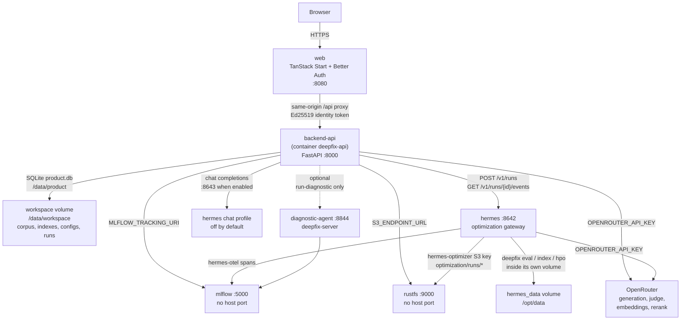
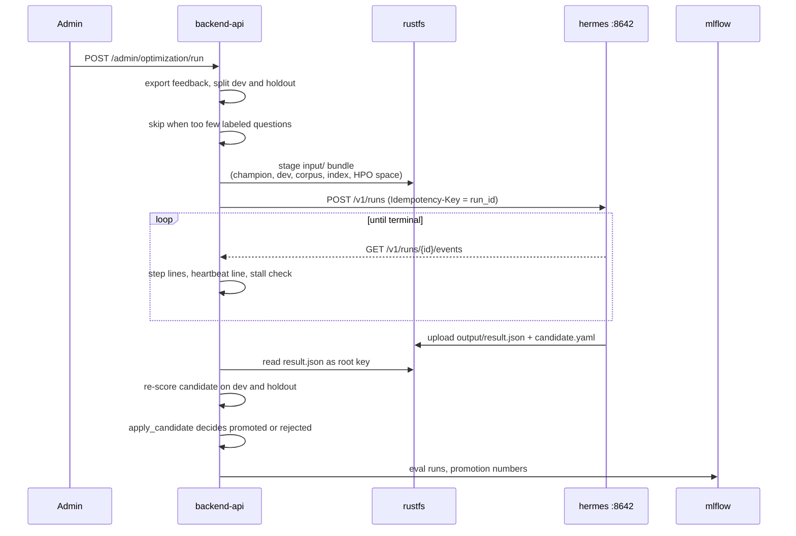
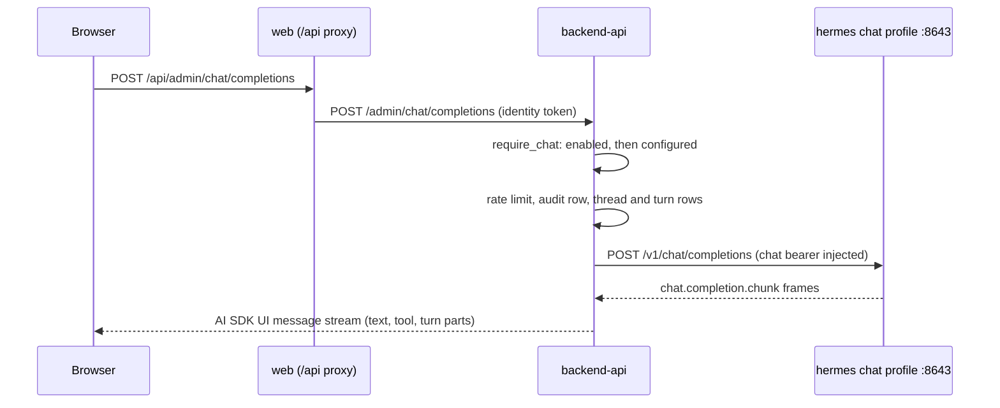

# DeepFix: Autonomous RAG Optimization

[](https://www.python.org/downloads/release/python-3120/)
[](LICENSE)
[](https://github.com/astral-sh/uv)
[](https://lancedb.com/)
[](https://github.com/confident-ai/deepeval)
[](https://mlflow.org/)

DeepFix is a RAG system built on [LlamaIndex](https://www.llamaindex.ai/) with a [LanceDB](https://lancedb.com/) vector store on [RustFS](https://rustfs.com/) (an S3-compatible object store), plus the tooling that tunes it.

The RAG pipeline is deterministic: chunking, dense/BM25/hybrid/graph retrieval, optional reranking, and synthesis are configured by one validated YAML file. Around that pipeline sit three concerns that are kept deliberately separate:

1. **A deterministic CLI (`deepfix`)** — `dataset`, `index`, `eval`, `gate`, `hpo`, `mutate-config`, `diff-config`, `schema`, `run-diagnostic`, `export`. Every command is scriptable, writes JSON to stdout under `--json`, and uses fixed exit codes.
2. **Agent skills** — twelve `SKILL.md` procedures a long-running agent reads to diagnose a failure mode and run one remediation round. The skills are Markdown; the agent is any agent that can call a CLI.
3. **A product stack** — a FastAPI service, a web app with accounts and an admin section, a Hermes sandbox that runs the optimization rounds, MLflow for experiment lineage, and RustFS for indexes and run bundles.

The optimizer is **Hermes**: one sandboxed agent run per round, within a 40-turn budget, testing one hypothesis. The agent proposes; the backend scores holdout and decides.

Developed by **Mittelstand Zukunftslab & AI Service Center (AISC) — HPI**.

---

## Architecture



| Service | Role | Published port |
| :--- | :--- | :--- |
| `web` (container `deepfix-web`) | TanStack Start app. Owns sign-in and sessions with Better Auth; proxies every other `/api/*` call to FastAPI with a short-lived identity token. Admin section at `/admin`. | none; Traefik proxies to `8080` |
| `backend-api` (container `deepfix-api`) | FastAPI product API: documents, index, retrieval, ask, feedback, history, the optimization job API, and the admin Hermes chat routes. One uvicorn worker, because SQLite, the index writer, and the APScheduler instance assume one process. | none; Traefik proxies to `8000` |
| `hermes` | The optimization sandbox. Its API server takes one run at a time and streams step events. A second, standalone chat profile can be started on `8643`. No Docker socket, no dashboard. | none |
| `mlflow` | Experiment tracking and the trace sink for `eval` and for the Hermes agent. It has no authentication of its own, so a Traefik router with a basic-auth middleware is the only way in. | none |
| `rustfs` | S3-compatible object store: the index cache and the per-run bundles under `optimization/runs/<run_id>/`. | none |
| `diagnostic-agent` | Optional DeepFix analysis server (`deepfix-server`) used only by `deepfix run-diagnostic`. | `8844` |
| `memgraph`, `falkordb` | Optional graph stores for the manual `graph` backend. Included by `compose.graphdb.yml`. The promotion gate rejects `graph` and `mixed`. | `7687`, `6379` |

`docker-compose.yml` includes `compose.hermes.yml`, which defines `hermes`, and `compose.graphdb.yml`, which defines the two graph stores. Remove the graph include on a deployment that does not use graph retrieval.

---

## Default models

Every model id is deployment configuration read from the environment. No model id has a default in the package: an empty value fails at the point of use and names the variable. The template values in `example.env` are the deployment defaults.

| Purpose | Variable | Model id | Endpoint |
| :--- | :--- | :--- | :--- |
| Answer generation and query expansion | `LLM_MODEL` | `qwen/qwen3.8-flash` | OpenRouter (`LLM_BASE_URL`) |
| DeepEval judge | `LLM_JUDGE_MODEL` | `z-ai/glm-5.3-flash` | OpenRouter (`LLM_BASE_URL`) |
| Hermes optimization agent | `HERMES_MODEL` | `deepseek/deepseek-v4.1-flash-1017` | OpenRouter (`HERMES_MODEL_BASE_URL`, optional) |
| Admin chat (defaults to `HERMES_MODEL`) | `HERMES_CHAT_MODEL` | unset | as `HERMES_MODEL` |
| Embeddings | `EMBEDDING_MODEL` | `perplexity/pplx-embed-v1-4b` | OpenRouter (`EMBEDDING_BASE_URL`) |
| Reranker | `COHERE_MODEL` | `cohere/rerank-4-fast` | `POST <COHERE_BASE_URL>/rerank` |

`embedding.model`, `rerank.model`, and `generation.model` are not configuration keys; `deepfix mutate-config` rejects them. The reranker is DeepFix's own HTTP client for OpenRouter's rerank API, authorized by `OPENROUTER_API_KEY`, which `backend-api` receives for exactly that call; the native Cohere `/v2/rerank` path is not called. `COHERE_API_KEY` survives only as a fallback the client reads when `OPENROUTER_API_KEY` is empty.

---

## Repository layout

```
deepfix-rag/
├── .agents/skills/                 <- The 12 agent skills the skills CLI installs
│   ├── optimization-loop/           <- Entry point: one round, start here
│   ├── hpo-search/                  <- The bounded query-time Optuna sweep
│   ├── chunking-tuning/             <- Index-time chunking hypothesis
│   ├── retrieval-backend-selection/ <- dense vs bm25 vs hybrid
│   ├── rerank-calibration/          <- Rerank on/off and top_k (reference)
│   ├── hybrid-fusion-tuning/        <- Fusion mode and weights (reference)
│   ├── query-rewriting/             <- Query expansion 1-3 (reference)
│   ├── embedding-selection/         <- Alias of retrieval-backend-selection
│   └── deflection-and-refusal/, legal-retrieval-grounding/,
│       multi-hop-aggregation/, diagnostic-server/  <- Manual/benchmark only
├── configs/                        <- RAG and HPO configuration (see configs/README.md)
├── docker/hermes/                  <- Hermes sandbox image, boot script, shim, run-tag plugin
├── docs/                           <- Deployment notes and the chat verification runbook
├── plugins/deepfix-rag/plugin.yaml <- Plugin manifest: the 12 skills plus their aliases
├── scripts/register_prompt.py      <- Registers the system prompt in MLflow
├── src/deepfix_rag/
│   ├── api/                        <- FastAPI app, routes, schemas, identity, chat relay
│   ├── cli/                        <- Typer subcommands and exit-code helpers
│   ├── config/                     <- Pydantic schema, settings, mutator, HPO space
│   ├── diagnostics/                <- Failure analysis client for deepfix-server
│   ├── evaluation/                 <- DeepEval runner, judge, MLflow tracker
│   ├── admin_chat.py               <- Chat store, audit trail, rate limits, prompt, digest
│   ├── data.py                     <- Loader strategies and the DataLoader facade
│   ├── documents.py                <- Workspace layout, uploads, champion seeding
│   ├── feedback.py                 <- Votes to dev/holdout questions, snapshot export
│   ├── hermes_client.py            <- Hermes runs API client and run instructions
│   ├── hermes_sync.py              <- deepfix-sync: bundle download and upload
│   ├── indexing.py                 <- Blue-green workspace builds and the index coordinator
│   ├── optimization.py             <- Run rows, Hermes supervision, stall detection
│   ├── optimization_schedule.py    <- APScheduler nightly job and audit prune
│   ├── pipeline.py                 <- LlamaIndex Workflow RAG pipeline
│   ├── promotion.py                <- Dev and holdout scoring, the gate, champion writes
│   ├── run_bundle.py               <- Run bundle layout, object store, holdout leak check
│   └── main.py                     <- `deepfix` CLI entry point
├── tasks/                          <- PRDs, stories, plans, implementation notes
├── tests/                          <- pytest suite (markers in pyproject.toml)
├── web/                            <- TanStack Start product UI (Bun, TypeScript)
├── compose.hermes.yml              <- The hermes service
├── compose.graphdb.yml             <- Optional memgraph and falkordb services
├── docker-compose.yml              <- web, backend-api, mlflow, rustfs, diagnostic-agent
├── example.env                     <- Environment template; copy to .env
├── Makefile                        <- requirements, data, lint, format, test
└── pyproject.toml                  <- Dependencies, Ruff, pytest configuration
```

---

## Installation

DeepFix installs in two pieces: the **skills** are Markdown procedures an agent reads, and the **CLI** is the deterministic tool those procedures call.

### Prerequisites

- **Python 3.12** — the package declares `requires-python = "~=3.12.0"`.
- **Node 22.20 or newer** — only for `npx`, which runs Vercel's [`skills`](https://github.com/vercel-labs/skills) installer. The web app uses Bun.
- **Java 11 or newer** — optional. `pyterrier` computes nDCG, recall, and precision; the `pt.Evaluate` path DeepFix uses runs without a JVM. Install a JDK only if you extend the evaluation code with Terrier index components.

### 1. Install the agent skills

```bash
npx skills add Mittelstand-Zukunftslab/deepfix-rag -y
```

That installs all twelve skills from `.agents/skills/` into your agent's directory for the current project. To install globally for Hermes:

```bash
npx skills add Mittelstand-Zukunftslab/deepfix-rag -g -a hermes-agent -y
```

List what a checkout publishes without installing anything:

```bash
npx skills add Mittelstand-Zukunftslab/deepfix-rag --list
```

### 2. Install the `deepfix` CLI

The package is not on PyPI. Install it from git with [`uv`](https://docs.astral.sh/uv/guides/tools/):

```bash
uv tool install "git+https://github.com/Mittelstand-Zukunftslab/deepfix-rag.git"
deepfix --help
```

The install also provides `deepfix-rag` (an alias) and `deepfix-sync` (the run-bundle helper). If `deepfix` is not on your `PATH` in a new terminal, run `uv tool update-shell` and open a new terminal.

### 3. Work on the source

```bash
git clone https://github.com/Mittelstand-Zukunftslab/deepfix-rag.git
cd deepfix-rag
uv sync                 # installs every dependency from uv.lock
source .venv/bin/activate
```

Or use the `Makefile`: `make create_environment` then `make requirements`.

### 4. Optional: the DeepFix analysis server

`deepfix run-diagnostic` is a client of a separate server package. The `diagnostic-agent` Compose service runs it for you. To install it yourself:

```bash
uv tool install "git+https://github.com/delcaux-labs/deepfix.git#subdirectory=packages/deepfix-server"
deepfix-server version
deepfix-server launch -host 127.0.0.1 -port 8844
```

The server has no authentication of its own, so the manual launch binds loopback. It reads its own `DEEPFIX_LLM_*`, `DEEPFIX_SEARCH_PROVIDER`, `NUM_REASONING_CHAINS`, `DEEPFIX_SERVER_DATABASE_URL`, `MLFLOW_TRACKING_URI`, and `MLFLOW_EXP_NAME` from the process environment or from a `.env` in the directory it is launched from; the CLI has no env-file flag. `.agents/skills/diagnostic-server/SKILL.md` is the full procedure. The optimization loop never calls it.

### 5. Optional: MLflow without Docker

```bash
uvx mlflow server --host 127.0.0.1 --port 5000
```

Then set `MLFLOW_TRACKING_URI` in `.env` to that address. The Compose `mlflow` service is the normal deployment and publishes no host port; see [MLflow and RustFS lockdown](#mlflow-and-rustfs-lockdown).

---

## Quick start

Create `.env` before the first command. Every model id comes from the environment, so `deepfix` fails naming the variable if `.env` is missing:

```bash
cp example.env .env
# then fill in the keys and endpoints you have
```

### 1. Ingest a benchmark

```bash
deepfix dataset load --name bundestag-qa --split train
```

`--split` names the output directory and must be `train`; anything else exits 1. Each loader picks its own upstream split (Bundestag `train`, Legal RAG Bench `test`). Files land in `data/processed/<dataset>/train/` as `corpus.jsonl` and `qa.jsonl`, or `corpus_<limit>.jsonl` and `qa_<limit>.jsonl` when `--limit` is given. The directory name is the preset or the last segment of the repo id, lowercased, so `--name bundestag-qa` writes `data/processed/bundestag-qa/train/`. `DATA_PROCESSES_DIR` overrides the root.

### 2. Build the index

```bash
deepfix index \
  --config configs/default.yaml \
  --dataset data/processed/bundestag-qa/train/corpus.jsonl \
  --index-dir data/indexes/bundestag_train \
  --force
```

The index is written to a LanceDB directory, or to an `s3://` URI when `--index-dir` (or `retrieval.lancedb_index_dir`) is one. `--if-changed` skips the build when the index manifest already matches the config.

### 3. Score the baseline

```bash
deepfix eval \
  --config configs/default.yaml \
  --dataset data/processed/bundestag-qa/train/qa.jsonl \
  --index-dir data/indexes/bundestag_train \
  --limit 20
```

`eval` never builds an index. A missing or empty `--index-dir` is filled from the config's own `s3://` index, manifest included. If the config's index is local too, the run fails with `error_type` `stale_index` instead of silently ingesting and scoring a brand-new index.

### 4. Propose a candidate

```bash
deepfix mutate-config \
  --base configs/default.yaml \
  --set rerank.enabled=true \
  --set rerank.top_n=5 \
  --set retrieval.top_k=20 \
  --output /tmp/candidate_v1.yaml

deepfix diff-config configs/default.yaml /tmp/candidate_v1.yaml
```

`mutate-config` validates every override against the Pydantic schema; an unknown key exits 1 with suggestions, and `index_time_changed` tells you whether a re-index is needed.

### 5. Compare and decide

```bash
deepfix eval \
  --config /tmp/candidate_v1.yaml \
  --compare configs/default.yaml \
  --dataset data/processed/bundestag-qa/train/qa.jsonl \
  --index-dir data/indexes/bundestag_train \
  --baseline-index-dir data/indexes/bundestag_train \
  --limit 20 --json > /tmp/compare.json

deepfix gate --compare /tmp/compare.json --primary ndcg --json
```

`--baseline-index-dir` lets the baseline score from the same local copy instead of re-reading its own `s3://` index. The compare payload carries `candidate`, `baseline`, `delta`, and per-query `questions`. `gate` passes only when the paired primary delta meets `OPTIMIZATION_MIN_PRIMARY_DELTA`, the seeded bootstrap interval lies above zero, no higher-is-better metric falls past `OPTIMIZATION_SECONDARY_TOLERANCE`, both sides scored every case, and neither side silently changed backend.

### 6. Register the system prompt in MLflow

```bash
python scripts/register_prompt.py
```

---

## Configuration

### Pipeline config (YAML)

Configurations are validated by `src/deepfix_rag/config/schema.py`. `configs/default.yaml` is the baseline the API seeds into a fresh workspace as `champion.yaml`.

```yaml
version: "1.0"
chunking:
  strategy: sentence        # sentence | recursive | fixed | semantic | hierarchical
  size: 1024                # 64 to 16000
  overlap: 64               # must be < size for sentence and fixed
embedding:
  batch_size: 32            # the model id is EMBEDDING_MODEL, not a config key
retrieval:
  backend: hybrid           # hybrid | dense | bm25 | graph | mixed
  top_k: 10                 # 1 to 100
  fusion_mode: reciprocal_rerank  # reciprocal_rerank | relative_score | dist_based_score | simple
  dense_weight: 0.5         # read only by relative_score and dist_based_score
  bm25_weight: 0.5          # read only by relative_score and dist_based_score
  language: german          # a PyStemmer algorithm name
  query_expansion_num: 1    # 0 to 8; above 1 calls an LLM
rerank:
  enabled: false
  top_n: 5                  # when enabled: top_n <= retrieval.top_k and eval.cutoff_k <= top_n
generation:
  temperature: 0.0
  max_tokens: 4096
eval:
  cutoff_k: 5               # nDCG@k, R@k, P@k. Independent of retrieval.top_k
```

Index-time keys force a rebuild when they change: `chunking.*`, `retrieval.backend`, `retrieval.vector_store`, `retrieval.bit_width`, `retrieval.graph_store`, `retrieval.graph_extraction_schema`, `retrieval.graph_max_paths_per_chunk`, `EMBEDDING_MODEL`, and the corpus hash. `deepfix schema --json` prints the live field list and the `index_time_keys`.

`configs/README.md` lists every shipped file and when to use it.

### Environment variables

Names and purpose only; `example.env` carries the values and one comment per group. Never commit a filled `.env`.

**Tracking**

| Variable | Purpose |
| :--- | :--- |
| `MLFLOW_TRACKING_URI` | Tracking server for every machine caller. Internal Compose name in the deployment. |
| `MLFLOW_DEV_RAG_EXPERIMENT` | Experiment `deepfix eval` logs to. |
| `MLFLOW_ENABLE_ASYNC_TRACE_LOGGING` | Enables MLflow's async trace flush. |
| `MLFLOW_BACKEND_STORE_URI` | SQLite store for the `mlflow` service. |
| `MLFLOW_PUBLIC_HOST` | Host the `mlflow` service's Traefik routers match. Must also appear in `MLFLOW_SERVER_ALLOWED_HOSTS`. Empty keeps the fail-closed `deepfix-mlflow.invalid` default. |
| `MLFLOW_BASIC_AUTH_USERS` | htpasswd user list for the `deepfix-mlflow-auth` Traefik middleware in front of the MLflow UI. A secret: generate with `htpasswd -nbB admin 'pass' \| sed -e 's/\$/\$\$/g'` and paste the output as-is. The `$$` doubling is required, because the server's docker-compose v1 re-interpolates `.env`. Empty fails closed. |
| `MLFLOW_SERVER_ALLOWED_HOSTS`, `MLFLOW_SERVER_CORS_ALLOWED_ORIGINS` | `Host` allow-list and CORS origins for the `mlflow` service. MLflow 3.x matches `Host` exactly, so `host` and `host:port` are separate entries. |

**Models and reranking**

| Variable | Purpose |
| :--- | :--- |
| `LLM_BASE_URL`, `LLM_API_KEY`, `LLM_MODEL` | Answer generation and query expansion. Inside Hermes these also reach `deepfix`, through the eval-env file and the shim. |
| `LLM_JUDGE_MODEL` | DeepEval judge. May differ from `LLM_MODEL` on the same endpoint. |
| `DEEPFIX_LLM_DROP_PARAMS` | Omits sampling parameters a provider rejects (some models allow only `temperature=1`). Applies to generation, the judge, and eval. Default on. |
| `EMBEDDING_BASE_URL`, `EMBEDDING_API_KEY`, `EMBEDDING_MODEL` | Embeddings for indexing and retrieval. |
| `COHERE_BASE_URL`, `COHERE_MODEL` | Reranker; the client posts to `<COHERE_BASE_URL>/rerank`. |
| `OPENROUTER_API_KEY` | Bearer for the rerank call and for the Hermes sandbox's model calls. Distinct from `LLM_API_KEY`. `backend-api` gets it for rerank; `COHERE_API_KEY` is only read when it is empty. |

**Storage and datasets**

| Variable | Purpose |
| :--- | :--- |
| `S3_ENDPOINT_URL`, `S3_URI`, `S3_REGION` | Object store endpoint, bucket/prefix, and region. |
| `S3_ACCESS_KEY_ID`, `S3_SECRET_ACCESS_KEY` | Root object-store key. Writes the run bundle; never given to Hermes. |
| `HF_TOKEN` | Hugging Face token for the dataset loaders. |

**Hermes and optimization**

| Variable | Purpose |
| :--- | :--- |
| `API_SERVER_KEY` | Bearer the API sends to the Hermes optimization gateway. At least 16 characters; placeholders are rejected. |
| `HERMES_BASE_URL` | Where the API reaches the optimization gateway. |
| `HERMES_MODEL`, `HERMES_MODEL_PROVIDER` | Agent model id and provider segment. `HERMES_MODEL` is required; the sandbox refuses to boot without it. |
| `HERMES_MODEL_BASE_URL` | Optional. A non-default OpenAI-compatible endpoint for that model. Unset means OpenRouter. |
| `HERMES_S3_ACCESS_KEY_ID`, `HERMES_S3_SECRET_ACCESS_KEY` | The `hermes-optimizer` key, limited to `optimization/runs/*`. |
| `OPTIMIZATION_AGENT` | Which agent runs a round. `hermes` is the only accepted value; anything else fails settings validation. |
| `OPTIMIZATION_MIN_DEV_QUESTIONS`, `OPTIMIZATION_MIN_NEW_DEV_QUESTIONS`, `OPTIMIZATION_MIN_HOLDOUT_QUESTIONS` | Minimum labeled questions before a run starts instead of being skipped. |
| `OPTIMIZATION_MIN_PRIMARY_DELTA` | Minimum dev delta on the primary metric for a promotion. |
| `OPTIMIZATION_SECONDARY_TOLERANCE` | How far a secondary metric may fall. |
| `OPTIMIZATION_RUN_TIMEOUT_HOURS` | Wall clock before a run is failed. |
| `OPTIMIZATION_HEARTBEAT_STALL_MINUTES` | Silence, in minutes, that fails a run as stalled. |

**Admin chat** (off by default)

| Variable | Purpose |
| :--- | :--- |
| `HERMES_CHAT_ENABLED` | Starts the chat profile's standalone gateway. `false` means no chat process and nothing on `8643`. |
| `HERMES_CHAT_API_SERVER_KEY` | Bearer for the chat profile only. Never the optimization key. |
| `HERMES_CHAT_MODEL` | Chat model; empty falls back to `HERMES_MODEL`. |
| `HERMES_CHAT_BASE_URL` | Where the API reaches the chat gateway. |
| `MLFLOW_HERMES_CHAT_EXPERIMENT` | Trace experiment for chat turns, separate from the optimizer's. |
| `ADMIN_CHAT_MAX_PROMPT_CHARS`, `ADMIN_CHAT_MAX_MESSAGES`, `ADMIN_CHAT_TURN_TIMEOUT_SECONDS`, `ADMIN_CHAT_DIGEST_MAX_CHARS`, `ADMIN_CHAT_MAX_TURNS_PER_WINDOW`, `ADMIN_CHAT_TURN_WINDOW_SECONDS`, `ADMIN_CHAT_MAX_CONCURRENT_TURNS`, `ADMIN_CHAT_ACTION_TTL_SECONDS`, `ADMIN_CHAT_STEP_TAIL`, `ADMIN_CHAT_STEP_READ_BYTES`, `ADMIN_CHAT_AUDIT_RETENTION_DAYS` | The ten request limits plus the audit retention window. Defaults are in `docker-compose.yml` and `src/deepfix_rag/config/settings.py`. |

**Diagnostic server and graph stores** (both optional)

| Variable | Purpose |
| :--- | :--- |
| `DEEPFIX_SERVER_URL`, `DEEPFIX_API_KEY` | Analysis server address and the key `deepfix-sdk` sends. |
| `DEEPFIX_LLM_API_KEY`, `DEEPFIX_LLM_BASE_URL`, `DEEPFIX_LLM_MODEL_NAME`, `DEEPFIX_LLM_TEMPERATURE`, `DEEPFIX_LLM_MAX_TOKENS`, `DEEPFIX_LLM_CACHE`, `DEEPFIX_LLM_TRACK_USAGE`, `LITELLM_DROP_PARAMS`, `DEEPFIX_SEARCH_PROVIDER`, `NUM_REASONING_CHAINS`, `DEEPFIX_SERVER_DATABASE_URL`, `MLFLOW_EXP_NAME` | The analysis server's own model, search, and storage settings. The server does not import this package, so these do not configure the API or the optimizer. |
| `MEMGRAPH_URL`, `MEMGRAPH_USERNAME`, `MEMGRAPH_PASSWORD` | Memgraph connection for `retrieval.backend=graph`. |
| `FALKORDB_HOST`, `FALKORDB_PORT`, `FALKORDB_USERNAME`, `FALKORDB_PASSWORD`, `FALKORDB_DATABASE` | FalkorDB connection for the same backend. |
| `RUSTFS_CONSOLE_ENABLE` | The RustFS console. Off by default and unreachable from the host. |

**Product API and web**

| Variable | Purpose |
| :--- | :--- |
| `WEB_ORIGIN` | Origin of the web app. Must equal `BETTER_AUTH_URL` in the web app: it is the token issuer and audience. |
| `AUTH_JWKS_URL` | Where the API fetches the public keys that sign identity tokens. Defaults to `<WEB_ORIGIN>/api/auth/jwks`. |
| `BETTER_AUTH_SECRET` | Better Auth signing secret for the web container. |
| `BETTER_AUTH_URL` | The web app's own public origin. |
| `API_INTERNAL_URL` | FastAPI as seen from the web container. |
| `ALLOWED_EMAIL_DOMAINS` | Comma-separated domains allowed to register. Empty allows anyone. |
| `PRODUCT_DATA_DIR`, `WORKSPACE_DIR` | SQLite database directory and the shared corpus/index/config workspace. |
| `DEEPFIX_LOG_LEVEL` | Console level for the `deepfix_rag` and `apscheduler` loggers. One of `DEBUG`, `INFO`, `WARNING`, `ERROR`, `CRITICAL`; an unknown value warns and falls back to `INFO`. |
| `DEEPFIX_WEB_HOST`, `DEEPFIX_API_HOST` | Public hostnames the `web` and `backend-api` Traefik routers match. Routing lives in `docker-compose.yml`, so these replace the Dokploy Domain entries. Empty keeps the fail-closed `*.invalid` default. |

The web app also reads `web/.env.example` for local development: `VITE_API_BASE_URL`, `API_INTERNAL_URL`, `BETTER_AUTH_SECRET`, `BETTER_AUTH_URL`, `AUTH_DATABASE_PATH`, and `ALLOWED_EMAIL_DOMAINS`.

**Advanced, unset by default**: `AUTH_ISSUER`, `AUTH_AUDIENCE`, `MAX_DISPLAYED_HITS`, `LLM_CONTEXT_WINDOW`, `DEEPFIX_INDEX_TIMEOUT_SECONDS` (0 disables the index workflow timeout), `DATA_ROOT`, `DATA_PROCESSES_DIR`, `DEEPFIX_HOME`.

---

## CLI reference

Every subcommand accepts `--json`: the JSON payload goes to stdout and logs go to stderr. Exit codes are `0` success, `1` validation error, `2` runtime error. `deepfix export` is not implemented and always exits 2; `deepfix dataset generate-unanswerable` is not implemented and always exits 2.

| Command | What it does |
| :--- | :--- |
| `deepfix dataset load` | `--name <preset_or_hf_repo> [--split train] [--limit N] [--subset corpus\|qa] [--corpus-only] [--data-root <dir>] [--json]` |
| `deepfix dataset list` | Lists locally ingested datasets and their split directories. |
| `deepfix index` | `--config <yaml> [--dataset <corpus>] [--index-dir <dir_or_s3_uri>] [--force] [--if-changed] [--json]` |
| `deepfix eval` | `--config <yaml> [--dataset <qa>] [--split <s>] [--index-dir] [--baseline-index-dir] [--compare <yaml>] [--limit N] [--concurrency N] [--retrieval-only] [--max-error-rate F] [--seed N] [--no-mlflow] [--run-id <id>] [--json]` |
| `deepfix gate` | `--compare <compare.json> [--primary ndcg\|recall\|precision\|<generation metric>] [--min-delta F] [--secondary-tolerance F] [--seed N] [--json]` |
| `deepfix mutate-config` | `--base <yaml> --set key.sub=value [--set ...] --output <yaml> [--json]` |
| `deepfix diff-config` | `[config_a] [config_b]` or `--base <yaml> --compare <yaml>` `[--json]` |
| `deepfix hpo` | `[--config <hpo.yaml>] [--n-trials N] [--storage-uri <uri>] [--paradigm <backend>] [--dataset <d>] [--split <s>] [--limit N] [--retrieval-only] [--tune-chunking] [--base-config <yaml>] [--output <yaml>] [--index-dir <dir>] [--run-dir <dir>] [--seed N] [--timeout S] [--json]` |
| `deepfix schema` | Prints the schema version, index-time keys, and top-level fields. |
| `deepfix run-diagnostic` | `[--dataset <d>] [--config <yaml>] [--server-url <url>] [--limit N] [--json]`. Needs a reachable analysis server. |
| `deepfix export` | Not implemented; exits 2. |

### `deepfix eval` details

- `--index-dir` moves only the candidate. `--baseline-index-dir` moves the `--compare` baseline, so one round can score both sides from one local copy of a remote index.
- `--seed` with `--limit` draws a deterministic sample instead of taking the first rows.
- `--max-error-rate` fails the run when the share of errored cases exceeds it.
- `--retrieval-only` scores nDCG, recall, and precision and calls neither the generation model nor the judge, so `LLM_MODEL` and `LLM_JUDGE_MODEL` are optional in that mode. `LLM_MODEL` is still required when `retrieval.query_expansion_num` is above 1 on a hybrid or mixed backend; each expanded question is one completion, cached per question and requested count for the whole run so a candidate and a `--compare` baseline share it.
- `expansion_llm_calls` and `expansion_cache_hits` report that cost: completions sent upstream, and prompts answered from the cache. They are not gate metrics.
- `--no-mlflow` scores locally and reports `mlflow_run_id: null`.
- Metric keys are unsuffixed: `faithfulness`, `context_precision`, `context_recall`, `answer_relevancy`, `contextual_relevancy`, `ndcg`, `recall`, `precision`, plus `deflection_rate`, `failure_distribution`, `errors`, `scored`, `effective_backend`, `configured_backend`, and `judge_failures`.

### `deepfix hpo` details

- `--seed` draws a deterministic sample for every trial, with the same semantics as `deepfix eval --seed`.
- `--timeout` caps the study's wall clock. `--run-dir` keeps `hpo_trials.json` and the best-so-far YAML fresh after every trial, so a timeout or a crash still leaves a usable candidate.
- When the base config names an `s3://` index, HPO copies that prefix once into `<run_dir>/idx-cache` (or the `--index-dir` you pass) and every trial reads the local copy. The copy also receives a `deepfix_index.json`, so a later `eval --index-dir` on the cache passes the staleness check.
- The exported candidate carries the base config plus tuned parameters only. `data.limit`, `data.path_or_repo`, and `retrieval.lancedb_index_dir` are trial-only overrides and never appear in it.
- A trial whose parameter set duplicates an earlier one is pruned without running an eval. `n_trials` counts evaluated trials, so pruning never shortens the budget; `pruned_trials` reports the overhead.
- A trial where every case errored is recorded `FAIL` rather than scored `0.0`. If no trial completes, the command exits 2 with the first trial's error.
- `--tune-chunking` samples chunking keys and re-indexes per trial. Never use it in an API-driven round.

`configs/hpo_retrieval_small.yaml` is the shipped query-time space: rerank on/off with `top_n` 5 or 10, `top_k` 10/20/50, query expansion 1 to 3, and the three fusion modes that read their weights. It excludes `bm25_k1`, `bm25_b`, and every chunking key. `.agents/skills/hpo-search/SKILL.md` is the procedure a round follows with it.

Expansion is the one sampled key that calls an LLM. Inside Hermes the generation model reaches `deepfix` through the root-owned `/opt/deepfix/eval-env` file the sandbox writes at boot (model ids and endpoint URLs only) and the shim, which puts those values back into the CLI child and maps `OPENROUTER_API_KEY` into `LLM_API_KEY` when the LLM endpoint is OpenRouter; no secret is written into the run bundle, the eval log, or the profile `.env` apart from the key the shim already reads. The pipeline caches each paraphrase per question and requested count for the whole study, and expansion 1 makes no call, so a 12-trial sweep on 20 questions pays at most 40 completions (counts 2 and 3, once each per question). An `eval --compare` scores both sides from one cache so the paired gate compares the same rewrites. A sweep that can sample expansion exits 1 with `error_type` `missing_model` when `LLM_MODEL` is empty, rather than failing trials one at a time.

---

## Benchmarks

| Benchmark | Preset / alias | Domain | Upstream split | Source |
| :--- | :--- | :--- | :--- | :--- |
| Bundestag QA | `bundestag-qa` | German parliamentary debates and legislative inquiry QA (DIP) | `train` | `wirthual/dip-bundestag-qa`, corpus `wirthual/dip-bundestag` |
| Bundestag corpus | `bundestag-corpus` | Corpus only | `train` | `wirthual/dip-bundestag` |
| Legal RAG Bench | `legal-rag-bench` | Statutory analysis and legal QA (US statutes, regulatory code, footnotes) | `test`, subsets `corpus` and `qa` | `isaacus/legal-rag-bench` |
| Custom | any path, directory, or `HF:<repo>` | Anything | your files | local JSON/JSONL or Hugging Face |

The loaders are strategies behind `DataLoader` (`src/deepfix_rag/data.py`): `BundestagLoader`, `LegalRagBenchLoader`, `HuggingFaceLoader` (the router), and `LocalFileLoader`.

---

## Product API and web app

`src/deepfix_rag/api/` is a FastAPI service around the same domain layer the CLI uses. `web/` is the TanStack Start app; its TypeScript client is generated from FastAPI's OpenAPI schema (`bun run generate:api`), and CI fails if the committed schema or client is stale.

- Accounts live in the web app (Better Auth, SQLite). Roles are `member` and `admin`. FastAPI verifies the Ed25519 identity token the web server attaches and keeps its own admin check as a backstop.
- Members share one workspace corpus: upload text, Markdown, and PDF files (20 MB each), search the index, and ask questions. Votes on passages and answers become the dev and holdout evaluation questions.
- Every `/api/*` call except `/api/auth/*` goes through the web server's same-origin proxy. The admin chat stream is the one path that speaks a streaming protocol; its reader is the single module in `web/src` allowed to parse an event stream.

Routes (all admin routes require the `admin` role):

| Area | Routes |
| :--- | :--- |
| Health | `GET /health` |
| Documents | `POST /documents`, `GET /documents`, `DELETE /documents/{doc_id}` |
| Index | `GET /index`, `POST /admin/index/rebuild` |
| Retrieval | `POST /retrieval`, `POST /ask`, `GET /interactions/{interaction_id}` |
| Feedback | `POST /feedback`, `POST /feedback/comments`, `GET /admin/feedback/summary` |
| History | `GET /admin/interactions`, `GET /admin/interactions/{interaction_id}` |
| Optimization | `GET /admin/optimization`, `PATCH /admin/optimization`, `POST /admin/optimization/run`, `POST /admin/optimization/runs/{run_id}/cancel` |
| Admin chat | `POST /admin/chat/completions`, `GET/POST /admin/chat/threads`, `GET/DELETE /admin/chat/threads/{thread_id}`, `GET /admin/chat/turns/{turn_id}/stream`, `GET /admin/chat/audit`, `POST /admin/chat/actions/{action_id}/confirm`, `POST /admin/chat/actions/{action_id}/reject`, `GET /admin/chat/threads/{thread_id}/runs`, `POST /admin/chat/threads/{thread_id}/runs/{run_id}` |

---

## The Hermes optimizer

Hermes is the only optimization agent. `OPTIMIZATION_AGENT` accepts `hermes` and nothing else, so a stale value in a server env file fails settings validation by name instead of being ignored.



**Job API.** Start is `POST /admin/optimization/run` (admin only), status is `GET /admin/optimization`, and cancel is `POST /admin/optimization/runs/{run_id}/cancel`. The same `start_optimization_run` function serves the nightly schedule, the *Run now* button, and a confirmed chat action, so the three cannot drift. Only one run may exist at a time; a second start is refused with `RunInProgress`.

**What the backend owns.** The dev/holdout split is derived from labeled feedback: roughly 20% of questions are holdout, chosen by a stable hash of the normalized query text, and the holdout question text never enters the run bundle (`reject_holdout_leaks` refuses a bundle that contains one). Holdout scoring, the gate, and promotion all stay in this process. The agent reads only dev data, writes `output/result.json` with a recommendation, and never promotes.

**`apply_candidate` is the only writer of `configs/champion.yaml`** after the workspace is seeded. `prepare_workspace` writes it once when the file does not exist, from `configs/default.yaml`; from then on `promotion.apply_candidate` validates the candidate, rebuilds the index beside the serving one when an index-time key changed, scores candidate and champion on dev and holdout, archives the previous champion under `configs/history/`, and replaces the file only on a promotion. Every other path treats the champion as read-only.

**The gate.** A candidate is promoted only when the primary metric gains at least `OPTIMIZATION_MIN_PRIMARY_DELTA` (default `0.025`) on dev, no higher-is-better metric falls past `OPTIMIZATION_SECONDARY_TOLERANCE` (default `-0.01`), the holdout primary delta is not negative, and the candidate wins more holdout questions than it loses. A rejection, a failed score, and a promotion are all stored on the run row with their deltas.

**Heartbeat and stall detection.** The `deepfix` shim in the sandbox rewrites `output/heartbeat.json` every 30 seconds while a command runs and prints one heartbeat line. The API follows the events stream and the heartbeat object; with no non-keepalive event and no fresh heartbeat for `OPTIMIZATION_HEARTBEAT_STALL_MINUTES` (default 5), the run fails as `Stalled: no heartbeat for N minutes.` rather than waiting out `OPTIMIZATION_RUN_TIMEOUT_HOURS`. `: keepalive` comments on the stream do not count as progress.

**The nightly schedule.** `optimization_schedule.OptimizationScheduler` runs in the API process on APScheduler 3.x (`BackgroundScheduler` + `CronTrigger`). The SQLite row is the source of truth; the live job is rebuilt from it at every start, so a restart and the `next_run_at` the admin screen shows cannot disagree. The default is `0 2 * * *` in `Europe/Berlin`. Missed fire times coalesce, `max_instances=1`, and a fire time is honoured for up to five minutes late; a schedule missed while the process was down is not caught up. `PATCH /admin/optimization` persists a new cron and reschedules at once; an invalid expression leaves both unchanged.

**The sandbox.** `docker/hermes/Dockerfile` pins `nousresearch/hermes-agent` by digest, adds a Python 3.12 venv for `deepfix`, the twelve skills read-only, and two plugins: `hermes-otel` for traces and `deepfix-run-tag` for the `deepfix.run_id` attribute. The optimization profile's toolsets are `terminal`, `file`, and `skills`; `agent.max_turns` is 40. `deepfix-sync download --run-id <id>` fetches the bundle and `deepfix-sync upload --run-id <id> --result ...` returns the answer.

**The secret scrub.** `optimization._secrets` / `_redact` removes every configured secret from step lines, heartbeats, terminal output, and stored reasons. The same key list, extended with the chat key, is used by the run-tag plugin and the CLI shim. Keep it in place: it is the only thing between a leaked value and the step log.

---

## Admin Hermes chat

An admin-only assistant that answers questions about this server's schedule, champion, and recent runs, and can hand the admin a typed action card.



- **Off by default.** `HERMES_CHAT_ENABLED=false` means no chat gateway process exists and nothing listens on `8643`. Every Hermes-facing chat route answers 503 with `code: "chat_disabled"`; `GET /admin/chat/audit` and `DELETE /admin/chat/threads/{thread_id}` stay reachable, because turning chat off must not hide what chat already did. The page renders a disabled state from `chat_enabled` on `GET /admin/optimization` and makes no chat request.
- **A separate gateway.** The chat profile is a standalone Hermes gateway on `8643`, started by boot only when the flag is true. It has no terminal, file, or code-execution toolset, so it cannot run `deepfix`. `HERMES_CHAT_API_SERVER_KEY` is its bearer; `API_SERVER_KEY` is never used for it.
- **Frontend.** A LibreChat-shaped page: a collapsible thread sidebar with **New chat** and threads grouped by Today / Yesterday / Previous 7 days / Older, a slim header with the thread title and the `HERMES chat` label, and a centred `max-w-3xl` message column with a docked composer. Assistant replies are prose with markdown and copyable code blocks; user messages are a small bubble. Light and dark appearance toggle from the header and the choice is remembered. Below the `md` breakpoint both the thread list and the app navigation are drawers.
- **One runtime per thread.** Each thread gets its own AI SDK `Chat` (`@assistant-ui/react-ai-sdk`), keyed and seeded from the server's stored history, so switching threads mid-stream cannot move a reply between conversations and a reload cannot duplicate a message. The transport aims at the same-origin route; the backend translates Hermes's OpenAI chunk frames into the AI SDK UI message stream and strips the upstream model id.
- **Shared components.** The composer bar and the markdown renderer are `web/src/components/chat/`, used by both this page and the member-facing Ask page rather than duplicated.
- **Action cards.** A reply may end with one fenced `deepfix-action` block naming `start_optimization_run` or `cancel_optimization_run`. Only the admin's confirm runs it, through the same domain function the Optimization screen uses. Promotion is unreachable from chat: `apply_candidate` and the holdout data are not exposed.
- **Threads, audit, and retention.** A thread delete is a hard delete, children before parent, in one transaction; audit rows survive it with `thread_deleted: true` and no message text. Audit rows are bounded by age only: `ADMIN_CHAT_AUDIT_RETENTION_DAYS` (default 14; `0` keeps them forever), pruned hourly by an interval job on the optimization scheduler, whether chat is on or off.
- **Tracing.** A chat turn is traced in `MLFLOW_HERMES_CHAT_EXPERIMENT` (default `deepfix_hermes_chat`), separate from the optimizer's `deepfix_hermes`, with `deepfix.chat_thread_id` and `deepfix.chat_turn_id` on the spans and `content_capture` off on both profiles.
- **Limits.** Prompt length, message count, one reply per admin at a time, a turn budget per window, a global concurrency cap, a wall clock per reply, an action-card TTL, the step-log tail size, and the retention window. Each is an `ADMIN_CHAT_*` variable with a default; a request past a limit is a readable 400 or a 429 with `Retry-After`, never a stack trace.

The operator verification procedure is `docs/admin-hermes-chat-verification.md`; the interface review of the
redesign is `docs/admin-chat-interface-review.md`.

---

## MLflow tracing

Two mechanisms write to MLflow:

- **Evaluation lineage.** `deepfix eval` opens one run per config and one parent run for a `--compare`, with parameters, metric tables, and the candidate/baseline roles.
- **Agent traces.** The sandbox has no native agent spans on the pinned Hermes image, so `hermes-otel` is installed outside the sealed Hermes venv and loaded through a `.pth` file. Boot writes `hermes_otel.yaml` with `type: mlflow` and `content_capture` off, and the chat profile gets its own copy with its own experiment. A small `deepfix-run-tag` plugin adds `deepfix.run_id` to an optimization round's spans and `deepfix.chat_thread_id` / `deepfix.chat_turn_id` to a chat turn's. The OTEL exporter environment variables are not set; the plugin owns the MLflow header.

Product search, ask, and feedback also trace to `deepfix_product` and `deepfix_product_feedback`; a tracing failure never fails the request.

---

## Published ports

`docker-compose.yml` publishes **no** host port for `web`, `backend-api`, `mlflow`, or `rustfs`. Every one of them is reachable only through the Traefik instance Dokploy runs, which attaches to the Compose network and proxies to the container port:

| Service | Container port | Published | How traffic arrives |
| :--- | :--- | :--- | :--- |
| `web` | `8080` | none | Routers declared in `docker-compose.yml`, host from `DEEPFIX_WEB_HOST` |
| `backend-api` | `8000` | none | Routers declared in `docker-compose.yml`, host from `DEEPFIX_API_HOST` |
| `mlflow` | `5000` | none | Routers declared in `docker-compose.yml`, behind basic auth |
| `rustfs` | `9000`, `9001` | none | Compose network only; the console stays off |

Routing for all three is defined in `docker-compose.yml`, not in Dokploy. Each service joins `dokploy-network`, sets `traefik.docker.network`, and declares an http router (`web`, with `redirect-to-https@file`) and an https router (`websecure`, `tls.certresolver=letsencrypt`), plus `traefik.http.services.<name>.loadbalancer.server.port`. `mlflow`'s https router also carries `deepfix-mlflow-auth`. The Dokploy Domain entries for these services must be **removed**, or a second router claims the same host.

The repo is therefore the single source of routing: a single-service `docker compose up --no-deps` from the plain compose file keeps the sites up. `mlflow`'s basic-auth user list is `MLFLOW_BASIC_AUTH_USERS`, a deployment secret; every `$` in the bcrypt hash must be doubled (`$$`), because the server's docker-compose v1 re-interpolates `.env`. Empty fails closed, so a missing secret leaves the UI shut rather than open.

Nothing here binds a host port for these four services. If a deployment genuinely needs host access for a probe, bind it to loopback (`127.0.0.1:8000:8000`) so it is not reachable from outside the machine.

`docker-compose.yml` declares `dokploy-network` as external. A laptop that runs the Compose stack instead of the dev servers needs that network to exist first:

```bash
docker network create dokploy-network   # once, on a host that is not Dokploy
```

`diagnostic-agent` (`8844`) and the optional `memgraph` / `falkordb` (`7687`, `6379`) still publish. They are optional, off the public path, and out of scope for this lockdown.

---

## MLflow and RustFS lockdown

MLflow has no authentication of its own, and the RustFS console has no IAM policy in front of it, so neither is published. `docker-compose.yml` declares no `ports:` entry for `mlflow` or `rustfs`, and `RUSTFS_CONSOLE_ENABLE` defaults to `false`.

| Service | Published port | Reached as | Who needs it |
| :--- | :--- | :--- | :--- |
| MLflow | none | `MLFLOW_TRACKING_URI` on the Compose network | `backend-api`, `hermes`, `diagnostic-agent` |
| RustFS S3 API | none | `S3_ENDPOINT_URL` on the Compose network | `backend-api`, `hermes`, LanceDB in both |
| RustFS console | none | not started | nothing in this repository |

Machine-to-machine traffic never leaves the host. A human reads the MLflow UI through the `mlflow` service's own Traefik routers: the `web` entrypoint redirects to HTTPS, and `websecure` terminates TLS and requires the `deepfix-mlflow-auth` basic-auth middleware. Both are labels in `docker-compose.yml`. Keep that domain's `Host` in `MLFLOW_SERVER_ALLOWED_HOSTS` and its origin in `MLFLOW_SERVER_CORS_ALLOWED_ORIGINS`, or MLflow rejects the request before the UI loads.

The middleware's user list is `MLFLOW_BASIC_AUTH_USERS`, a deployment secret. Generate it with `htpasswd -nbB admin 'pass' | sed -e 's/\$/\$\$/g'` and paste the output: every `$` in the bcrypt hash must be doubled, because the server's docker-compose v1 re-interpolates `.env` and a single-`$` hash is corrupted, failing every login. Doubling is also required in Dokploy's Environment tab, which writes that value into the same `.env`. Empty fails closed: a user list with no entries authenticates nobody, so the UI refuses to open rather than opening unprotected.

The routers are declared here, not in Dokploy, so a redeploy cannot drop the middleware. `mlflow` therefore has **no Dokploy Domain entry**: remove one if it exists, or two routers claim the same `Host` and which one answers is undefined.

`mlflow_run_url()` builds the admin *open run* link from `MLFLOW_TRACKING_URI`. With an internal host it returns nothing and the admin table shows a dash instead of an unopenable link. `S3_URI`, `S3_REGION`, and the IAM keys do not depend on the endpoint: the URI names a bucket and key, not a host.

To inspect either service by hand:

```bash
docker compose exec backend-api python -c \
  "import urllib.request; print(urllib.request.urlopen('http://mlflow:5000/health').status)"
docker compose run --rm --entrypoint sh backend-api   # curl mlflow, or talk S3 to rustfs
```

Rollback is local and leaves data alone: re-add a `ports:` entry, set `RUSTFS_CONSOLE_ENABLE=true`, or re-add a domain. Nothing here deletes the `mlflow_artifacts` or `rustfs_data` volume, changes a bucket policy, or rotates a key.

`memgraph` and `falkordb` are outside this lockdown. `compose.graphdb.yml` publishes `7687` and `6379`; they are optional, and the promotion gate rejects the `graph` and `mixed` backends a round would need them for. Remove that include where graph retrieval is not used.

---

## Deployment

The deployment target is Dokploy with one Compose stack. Full notes are in `docs/deployment.md`; the short version:

- **Rebuild only the service you changed.** `docker compose up -d --no-deps --build <service>` keeps the rest of the stack running. Which service to rebuild: `backend-api` for anything in `src/deepfix_rag/` or `configs/`; `hermes` for `docker/hermes/` or `.agents/skills/`; `web` for `web/`; `mlflow` and `rustfs` only for their own settings.
- **Leave auto-deploy off.** The host has 7.6 GB of RAM. A full-stack rebuild restarts every container at once, and the pull, build, and restart burst is what runs the host out of memory. Deploy by hand, one service at a time.
- **Know the memory caps.** `mem_limit` is a cap, not a reservation: `hermes` 4 GB (plus `cpus: "2"`), `mlflow` 2 GB, `rustfs` 1 GB, `diagnostic-agent` 1 GB, `memgraph` and `falkordb` 1 GB each. Do not raise `hermes`'s limits to fix a slow round; lower `ADMIN_CHAT_MAX_CONCURRENT_TURNS` first, then the chat timeouts and prompt cap.
- **One API worker.** The container runs one uvicorn worker; SQLite, the index writer, and the scheduler assume it.
- **Secrets live in the deployment environment**, never in the repository. Set the keys listed in "Environment variables" as Dokploy environment variables and leave `example.env` untouched.

---

## Development and testing

DeepFix uses [pytest](https://docs.pytest.org/) and [Ruff](https://docs.astral.sh/ruff/). Contributor conventions — branch, commit, PRD and story workflow, testing philosophy — are in [`AGENTS.md`](AGENTS.md).

```bash
# Fast suite: skips the live network and end-to-end cases
uv run --env-file .env pytest -v -m "not network and not e2e"
# or
make test
```

### Markers

| Marker | What it covers |
| :--- | :--- |
| `unit` | No network, no heavy backends. Schema, mutators, helpers, skills contract. |
| `cli` | Typer commands, JSON contract, exit codes. |
| `integration` | Local filesystem, LanceDB, loaders, the API app. |
| `e2e` | Full ingestion, embedding, and retrieval. |
| `network` | Live Hugging Face or OpenRouter endpoints. |
| `api` | FastAPI routes, schemas, and the OpenAPI contract. |

`tests/conftest.py` deselects every `network` case unless the run names `network` or `e2e` in `-m`, or points at a test file by path. A command-line `-m` replaces `addopts` instead of intersecting with it, which is why the guard exists.

### Shared fixtures

`cli_runner`, `default_config_path`, `sample_corpus_path`, `sample_qa_path`, `default_rag_config`, `sample_rag_config`, `populated_sample_index_dir`, and `identity` (a signing key and the matching verifier for API tests).

Tests run against real code and local fixtures. Domain logic is not mocked.

### Style

```bash
uv run ruff check --fix
uv run ruff format
```

Line length 99, first-party package `deepfix_rag`, lint rules `E`, `F`, `I`.

---

## License

MIT — see [LICENSE](LICENSE).
