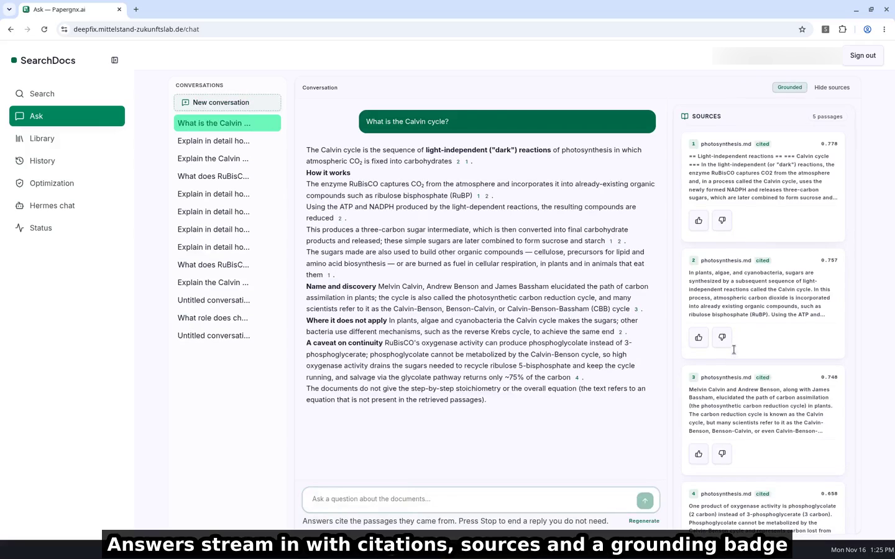
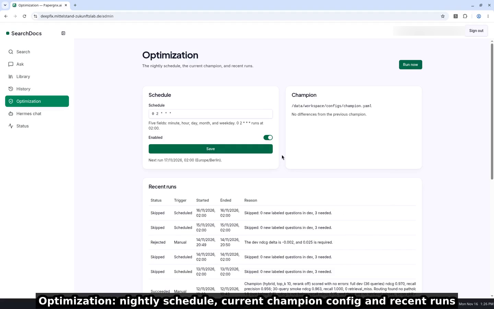
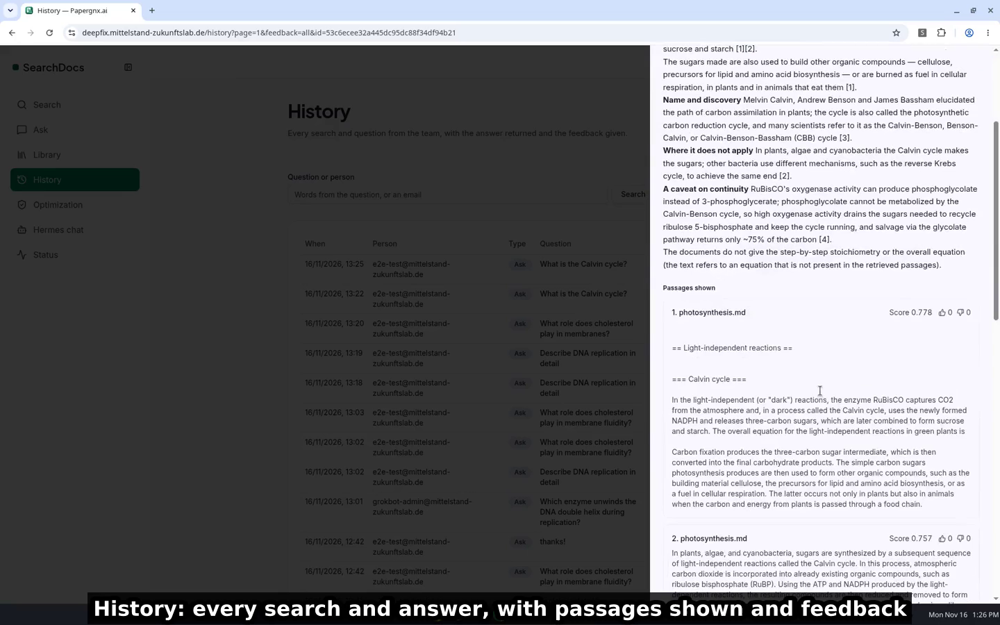
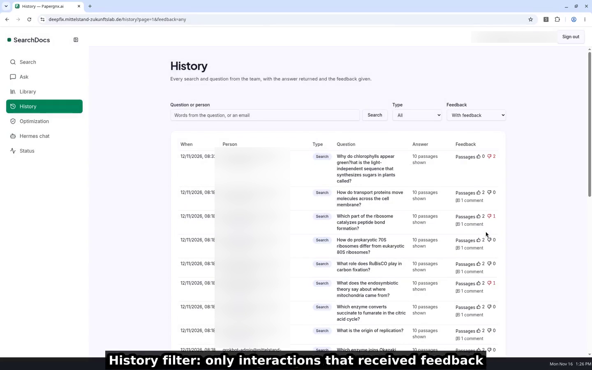
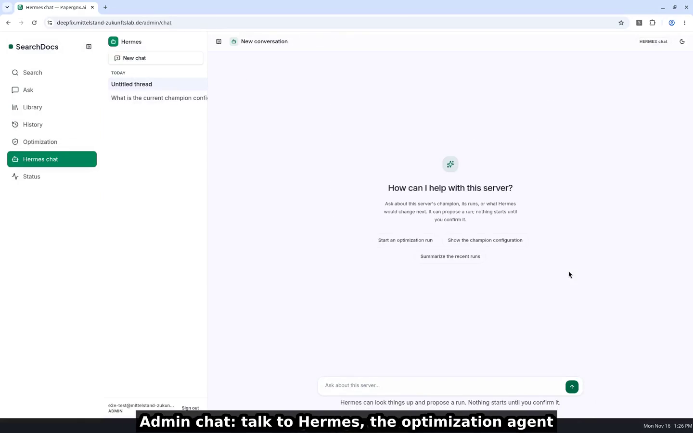
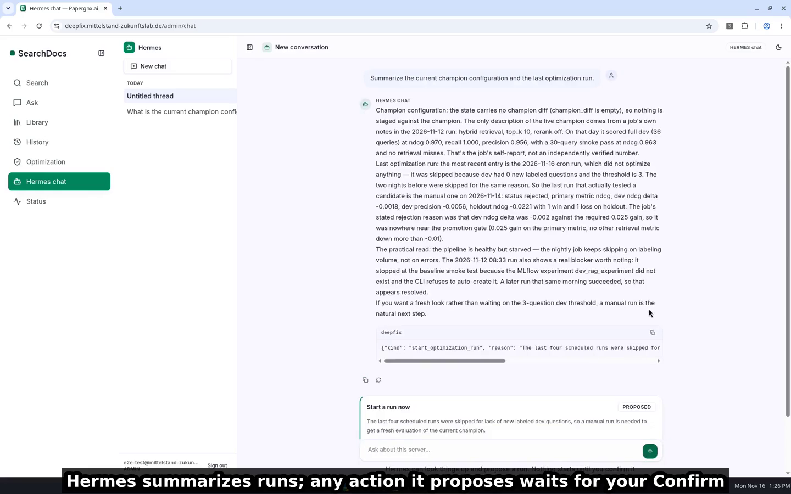

# Admin mode: a user guide

DeepFix has two kinds of account. A **member** uploads documents, searches them, asks questions, and votes on the passages and answers they see. An **admin** does all of that and also opens three pages the member never sees: **History**, **Optimization**, and **Hermes chat**.

This guide walks through those pages in the order the [Admin mode tour](media/deepfix-admin-tour.mp4) shows them. The stills below are frames from that recording, so what you see here is what the running stack looks like. Captions are burned into the video; the same cues are in [`media/deepfix-admin-tour.srt`](media/deepfix-admin-tour.srt).

| Asset | Where |
| :--- | :--- |
| Recording | [`media/deepfix-admin-tour.mp4`](media/deepfix-admin-tour.mp4) — 104 s, 1440×900, no audio |
| Captions | [`media/deepfix-admin-tour.srt`](media/deepfix-admin-tour.srt) |
| Preview | [`media/deepfix-admin-tour-preview.gif`](media/deepfix-admin-tour-preview.gif) |

The account email that the recording shows in the header, in the sidebar, and in the History table belongs to a test account, so it is blurred in the video, in the GIF, and in every still here.

## What admin means

- The web app's navigation hides **History**, **Optimization**, and **Hermes chat** from a member (`ADMIN_PATHS` in `web/src/components/layout/navigation.ts`), and each of those routes renders a "This page is only available to admins." panel instead of a half-loaded screen.
- The web app's server functions for those pages are wrapped in `requireRole("admin")`, which answers 403 "Only admins can review history." (or the matching sentence) before it forwards anything to FastAPI.
- The API refuses them independently: `require_admin` in `src/deepfix_rag/api/deps.py` answers 403 `FORBIDDEN` with "Only admins can do this." for every `/admin/*` route. The UI gate is convenience; the API gate is the one that matters.
- Nothing in admin mode edits a config file by hand. The champion is written by `promotion.apply_candidate` and by nothing else, so what the admin screens show and what the pipeline reads cannot drift apart.

---

## 1. Ask — 00:02 to 00:31

Ask is not admin-only, but it is where the corpus earns its keep, so the tour starts there.

- A question is typed into **New conversation**. Each conversation is a thread in the sidebar, and the thread keeps its own history.
- The answer **streams in** with numbered citations. Clicking a citation opens the sources panel, scrolls the matching passage into view, and highlights it.
- The **sources panel** on the right lists every retrieved passage with its file name and rerank score (0.778, 0.757, 0.748 in the frame above). Each passage keeps its own 👍/👎 buttons whatever the answer's badge says.
- The **grounding badge** in the header says how well the answer is backed: *Grounded*, *Partly grounded*, *Reused earlier evidence*, *Not searched*, *Not found in the documents*, or a *Stopped* variant. An answer that could not be grounded is badged as such rather than presented as fact.
- **Stop** ends a reply you do not need. The partial text and the passages it used stay on screen, and the badge says so.

Passages below `rerank.min_relevance_score` (default `0.3`) never reach the model or the panel, which is why a question the corpus cannot answer comes back as *Not found in the documents* instead of a confident guess. **Regenerate** asks again from the same question.

> Ask chat streaming, multi-turn threads, Stop, and the full badge set arrive with [PR #23 (`feat/ask-chat-streaming`)](https://github.com/Mittelstand-Zukunftslab/deepfix-rag/pull/23). On `feat/hermes-optimizer` today, Ask answers one question at a time and returns the finished reply. The recording was made from a stack running the Ask chat from that branch.

## 2. Optimization — 00:31 to 00:41

`/admin` is the optimizer's control panel. Three cards:

**Schedule.** A five-field cron expression and an **Enabled** switch. The shipped default is `0 2 * * *`, so a round starts at 02:00 in `Europe/Berlin`; the card shows the timezone and the next fire time ("Next run 17/11/2026, 02:00 (Europe/Berlin)"). **Save** writes the cron to SQLite and reschedules the live job at once. An invalid expression leaves both the stored cron and the running job untouched and shows the error on the field. While the schedule is paused, **Run now** still works.

**Champion.** The path of the config the pipeline is serving from (`/data/workspace/configs/champion.yaml`) and a plain-language diff against the previous champion. "No differences from the previous champion" means the last accepted candidate matched what was already serving, or nothing has been promoted since the workspace was seeded.

**Recent runs.** One row per run: status (Running, Skipped, Rejected, Promoted, Succeeded, Failed), trigger (Scheduled or Manual), start and end, the reason, the dev and holdout deltas on the primary metric, the holdout win/loss count, and an MLflow link when `MLFLOW_TRACKING_URI` is a host a browser can open. The reasons are the interesting part:

- *Skipped: 0 new labeled questions in dev, 3 needed.* — runs need fresh votes before they are worth spending a sandbox on.
- *The dev ndcg delta is -0.002, and 0.025 is required.* — the gate, stated as a sentence.
- A succeeded run reports its dev ndcg, recall, and precision.

**Run now** starts a round immediately through the same `start_optimization_run` the schedule and a confirmed chat action use. Only one run may exist at a time; the button is disabled while one is running and a **Cancel run** button appears beside it. If Hermes is not configured, the page says so and the button stays disabled, but the schedule and history still render.

## 3. History — 00:41 to 01:07

`/history` is the audit view of the corpus in use: every search and every question from the team, with the answer returned and the feedback given.

The table shows **When**, **Person**, **Type** (Search or Ask), **Question**, **Answer** (a truncated answer, or `10 passages shown` for a search with no answer), and a feedback summary — 👍/👎 counts on passages plus a comment count. Selecting a row — or its question — opens a side panel with:

- the **full answer** with its vote counts and any comments on it, citations intact,
- **passages shown**, each with its rank, file name, score, its own vote counts, and any comments,
- the **config path and serving build id** the interaction was answered from, which is what makes an old answer reproducible.

The filters across the top are a free-text box over the question text and the person's email, a **Type** selector (All, Searches, Asks), and a **Feedback** selector.

**With feedback** narrows the table to the rows that got a vote or a comment, which is the shortest path to "what did people think was wrong". The other values are *Negative feedback*, *With comments*, and *No feedback*. The filter lives in the URL (`?page=1&feedback=any`), so a filtered view can be bookmarked or pasted into an issue.

History is also the input to the optimizer: votes turn into the dev and holdout questions a run is scored on, and roughly 20% of them are held out where the sandbox never sees them.

## 4. Hermes chat — 01:07 to 01:36

`/admin/chat` is a chat with the optimizer itself. It can read this server's state — the schedule, the champion config, the recent runs and their step logs — and answer questions about them, so "why did the last run not promote?" is a question you can ask instead of a table you have to read.

- The sidebar groups threads by Today / Yesterday / Previous 7 days / Older. **New chat** starts an empty one.
- The welcome state offers three quick actions: *Start an optimization run*, *Show the champion configuration*, *Summarize the recent runs*.
- Replies are prose with markdown and copyable code blocks. A turn is traced to `MLFLOW_HERMES_CHAT_EXPERIMENT`, separately from the optimizer's own traces.

The frame above is the important one. Hermes summarized the champion and the last runs, and then proposed an action: **Start a run now**, badged `PROPOSED`, with its reason — the last four scheduled runs were skipped for lack of new labeled dev questions, so a manual run is needed to get a fresh evaluation.

Nothing has started. The card is a proposal, and the footer says so: *"Hermes can look things up and propose a run. Nothing starts until you confirm it."* The **Confirm** and **Dismiss** buttons sit under that line (they are below the fold of this frame); **Confirm** is the write, and it goes through the same domain function as the *Run now* button. A card expires after `ADMIN_CHAT_ACTION_TTL_SECONDS` (default 600).

The safety model, in one place:

| Question | Answer |
| :--- | :--- |
| Who can reach it | Admins only, in the UI and again in the API (403 for members). |
| What Hermes can do | Read the schedule, champion, runs, and step logs; answer; propose up to two action cards per reply — start a run, or cancel the running one. |
| What Hermes cannot do | Run a shell, read files, run `deepfix`, promote a candidate, or reach holdout data. Its gateway has no terminal or file toolset, and promotion exists only inside `promotion.apply_candidate` in the API process. |
| What starts a paid run | One thing: an admin pressing **Confirm** on a card, or **Run now**, or the nightly schedule. |
| What is recorded | Every turn in the audit trail, with a hard-deleted thread leaving a row that says it was deleted and no message text. Rows are pruned by age only (`ADMIN_CHAT_AUDIT_RETENTION_DAYS`, default 14; `0` keeps them). |

Chat is off unless `HERMES_CHAT_ENABLED=true`. With it off there is no chat gateway process, the three admin chat surfaces answer 503 `chat_disabled`, and the page renders its disabled state. The audit route stays reachable, because turning chat off must not hide what chat already did.

## 5. Back on Optimization — 01:35 to 01:44

The recording ends where the loop closes: back on `/admin`, with the schedule, the champion, and the run history in one view. That is the operator's home. A round that Hermes proposed, an admin confirmed, and the gate accepted shows up here as a promoted run with its deltas, and as a new diff on the Champion card.

---

## Where to go next

- [`admin-hermes-chat-verification.md`](admin-hermes-chat-verification.md) — the operator runbook for verifying chat on a deployed stack, with chat off and on.
- [`admin-chat-interface-review.md`](admin-chat-interface-review.md) — the design review behind the chat interface: findings, rejections, and what is still unverified.
- [`deployment.md`](deployment.md) — memory caps, rebuild order, and why auto-deploy stays off.
- [`../README.md`](../README.md) — architecture, configuration, the CLI, and how the optimizer decides.
