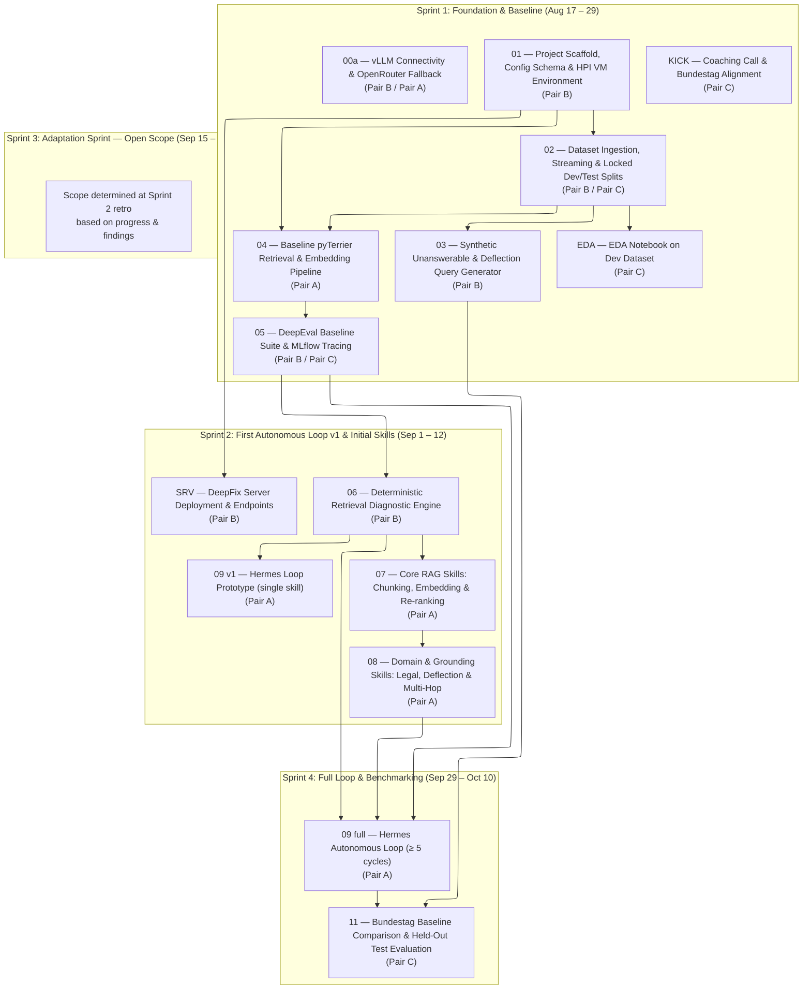

# DeepFix — Implementation Tickets (Tracer-Bullet Slices)

This document breaks down the **DeepFix Optimization CLI & Agent-Agnostic Skill Plugin** into vertical tracer-bullet tickets following the `to-tickets` skill specification. Each ticket delivers an end-to-end verifiable slice (schema/API, CLI, agent skills, evaluation, tests), declares its blocking dependencies, and maps to the sub-team pairs and sprint timeline defined in the **Pilot Project Agreement** (`Pilot_Project_Agreement_DeepFix.tex`).

- **Source PRD:** [prd-deepfix-cli.md](file:///d:/workspace/ai-use-cases/Mittelstand-zukunftslab/tasks/prd-deepfix-cli.md)
- **Source UX Flow Plan:** [plan-deepfix-ux-flow.md](file:///d:/workspace/ai-use-cases/Mittelstand-zukunftslab/tasks/plan-deepfix-ux-flow.md)
- **Pilot Project Agreement:** [Pilot_Project_Agreement_DeepFix.tex](file:///d:/workspace/ai-use-cases/Mittelstand-zukunftslab/HPI-deepfix/Pilot_Project_Agreement_DeepFix.tex)

---

## 1. Dependency Graph & Slicing Overview

---

## 2. RACI & Sub-Team Mapping

| Sub-Team Pair | Members | Primary Focus | Assigned Tickets |
| :--- | :--- | :--- | :--- |
| **Pair A — Implementation** | — | Hermes harness tuning, agent skill library, pyTerrier retrieval stack, autonomous AutoResearch loop | Tickets 00a (support), 04, 07, 08, 09 |
| **Pair B — Infrastructure & Diagnostics** | — | CLI scaffold, config schemas, HPI VM endpoints, DeepFix server, MLflow tracing, dataset splits, diagnostic engine | Tickets 00a, 01, 02, 03, 05, 06, SRV |
| **Pair C — Evaluation & Benchmarking** | — | DeepEval suites, EDA, evaluation analysis, held-out test benchmarking, Bundestag baseline liaison | Tickets 02 (splits), 05, EDA, KICK, 11 |

---

## 3. Implementation Tickets (Tracer-Bullet Slices)

### Ticket 00a: vLLM Connectivity Verification & OpenRouter Fallback
- **Owner / Pair:** **Pair B** / **Pair A**
- **Sprint:** Sprint 1 (Aug 17 – 29)
- **Status:** ready-for-agent
- **Blocked by:** None — can start immediately.

#### What to build
Verify client connectivity to HPI-deployed vLLM inference endpoints (Qwen 3.6 27B and Qwen3-Embedding-4B). Model deployment on the HPI VM is handled by HPI ops. If the HPI VM deployment is not ready during Sprint 1, configure OpenRouter as a temporary inference fallback to unblock downstream tickets (T04, T05).

#### Acceptance criteria
- [ ] `deepfix` client module successfully connects to vLLM inference endpoint (HPI VM or OpenRouter).
- [ ] Integration test confirms embedding responses from Qwen3-Embedding-4B (or OpenRouter equivalent).
- [ ] Integration test confirms generation responses from Qwen 3.6 27B (or OpenRouter equivalent).
- [ ] OpenRouter fallback config documented in `RAGConfig` schema with `DEEPFIX_INFERENCE_PROVIDER` environment variable (`hpi` | `openrouter`).
- [ ] Fallback switch is transparent to downstream CLI subcommands — no code changes needed when HPI VM becomes available.

---

### Ticket 01: Project Scaffold, Config Schema & HPI VM Environment
- **Owner / Pair:** **Pair B**
- **Sprint:** Sprint 1 (Aug 17 – 29)
- **Status:** ready-for-agent
- **Blocked by:** None — can start immediately.

#### What to build
Initialize the `deepfix` Python package repository structure, establish the Typer CLI entrypoint, implement the Pydantic `RAGConfig` validation schema, configure client connectivity for self-hosted vLLM inference endpoints on the HPI VM (Qwen 3.6 27B and Qwen3-Embedding-4B), and build the deterministic `deepfix mutate-config` and `deepfix diff-config` subcommands.

#### Acceptance criteria
- [ ] Installable package structure under `deepfix/` with `pyproject.toml` managing dependencies (`typer`, `pydantic`, `rich`, `mlflow`, `pyterrier`, `deepeval`).
- [ ] `deepfix.config.schema.RAGConfig` Pydantic model enforces validation for chunk sizes, overlap, embedding models, top-k, re-rankers, and prompt parameters.
- [ ] `deepfix mutate-config --base <base.yaml> --set <key=value> --output <new.yaml>` successfully validates and applies parameter modifications.
- [ ] `deepfix diff-config <config_a.yaml> <config_b.yaml>` outputs readable structural diffs in terminal and JSON format.
- [ ] Client connectivity module handles REST calls to HPI VM vLLM endpoints via `DEEPFIX_VLLM_URL` environment variable.
- [ ] Unit tests (`tests/test_config.py`): verify schema validation, invalid parameter rejection, mutation logic, and diff serialization.

---

### Ticket 02: Dataset Ingestion, Streaming & Locked Dev/Test Splits
- **Owner / Pair:** **Pair B** / **Pair C**
- **Sprint:** Sprint 1 (Aug 17 – 29)
- **Status:** ready-for-agent
- **Blocked by:** Ticket 01

#### What to build
Implement the `deepfix dataset load` subcommand with adapters for key text-only RAG benchmark datasets (**GaRAGe**, **bLLeQA**, **Legal RAG Bench**, **BrowseComp-Plus**, **EnterpriseRAG-Bench**, **mtRAG**) and custom JSONL collections. Include streaming download capabilities (`--stream`) for large-scale enterprise corpora and enforce strict dev/test split isolation in the repository.

#### Acceptance criteria
- [ ] `deepfix dataset load --name <preset> --split <dev|test>` downloads and standardizes datasets into local cache (`~/.deepfix/datasets/`).
- [ ] Native Hugging Face loading integration for `isaacus/legal-rag-bench`.
- [ ] Streaming loader (`--stream`) efficiently streams large datasets (>500K documents in EnterpriseRAG-Bench) in chunked batches without high RAM overhead.
- [ ] Strict dev/test split lock: dev split is exposed to the agent optimization loop; held-out test split is sealed for final evaluation.
- [ ] Unit tests (`tests/test_dataset_loaders.py`): assert proper ingestion, JSONL schema validation, and dev/test isolation for preset datasets.

---

### Ticket 03: Synthetic Unanswerable & Deflection Query Generator
- **Owner / Pair:** **Pair B**
- **Sprint:** Sprint 1 (Aug 17 – 29)
- **Status:** ready-for-agent
- **Blocked by:** Ticket 02

#### What to build
Implement the `deepfix dataset generate-unanswerable` subcommand that synthesizes out-of-domain and unanswerable query sets from custom corpora using semantic perturbation and out-of-scope question generation, providing ground-truth data for evaluating deflection and refusal capabilities.

#### Acceptance criteria
- [ ] `deepfix dataset generate-unanswerable --dataset <path> --ratio <0.2> --output <path>` generates synthetic unanswerable queries.
- [ ] Produced dataset flags answerable vs. unanswerable query targets in standard `qrels.jsonl` format.
- [ ] Output includes baseline perturbation logs for developer review.
- [ ] Unit tests (`tests/test_synthetic_queries.py`): assert correct query ratio generation, ground-truth tagging, and reproducible seed handling.

---

### Ticket 04: Baseline pyTerrier Retrieval & Embedding Pipeline
- **Owner / Pair:** **Pair A**
- **Sprint:** Sprint 1 (Aug 17 – 29)
- **Status:** ready-for-agent
- **Blocked by:** Ticket 01, Ticket 02

#### What to build
Implement the `deepfix index` subcommand wrapping pyTerrier to construct vector, BM25, and dense-lexical hybrid indexes. Integrate embedding inference against the self-hosted Qwen3-Embedding-4B model on the HPI VM and provide batched indexing for large-scale document collections.

#### Acceptance criteria
- [ ] `deepfix index --dataset <path|preset> --config <config.yaml> --index-dir <dir>` builds and persists the pyTerrier index.
- [ ] Supports Dense (Qwen3-Embedding-4B), Lexical (BM25), and Hybrid retrieval pipelines.
- [ ] Batch processing handles high-volume corpora (e.g. EnterpriseRAG-Bench, BrowseComp-Plus) with progress reporting.
- [ ] Integration tests (`tests/test_retrieval_indexing.py`): verify index creation, query execution, vector retrieval correctness, and top-k ranking outputs.

---

### Ticket 05: DeepEval Baseline Suite & MLflow Tracing
- **Owner / Pair:** **Pair B** / **Pair C**
- **Sprint:** Sprint 1 (Aug 17 – 29)
- **Status:** ready-for-agent
- **Blocked by:** Ticket 04

#### What to build
Implement the `deepfix eval` subcommand integrating DeepEval to compute Faithfulness, Contextual Precision, Answer Correctness, and Deflection/Refusal rates. Wire automatic experiment logging and auto-trace span tree capture into the MLflow tracking server deployed on the HPI VM.

#### Acceptance criteria
- [ ] `deepfix eval --dataset <path|preset> --config <config.yaml> --json` executes evaluation and returns machine-readable JSON metrics.
- [ ] Automatically logs metric scalars, evaluation test cases, and configuration YAML artifacts to MLflow under the active experiment run.
- [ ] Multi-turn conversational evaluation correctly evaluates context retention on mtRAG.
- [ ] Integration tests (`tests/test_eval_runner.py`): assert DeepEval metric extraction, unanswerable query deflection scoring, and MLflow run creation.

---

### Ticket EDA: EDA Notebook on Dev Dataset
- **Owner / Pair:** **Pair C**
- **Sprint:** Sprint 1 (Aug 17 – 29)
- **Status:** ready-for-agent
- **Blocked by:** Ticket 02

#### What to build
Produce an exploratory data analysis notebook on the dev dataset splits covering dataset statistics, distribution analysis, and quality observations to inform evaluation design and skill development.

#### Acceptance criteria
- [ ] Dataset statistics (document counts, query counts, length distributions, label distributions) computed for all loaded dev splits.
- [ ] Visualizations (histograms, box plots) for document and query length distributions.
- [ ] Key observations and data quality notes documented in the notebook.
- [ ] Notebook committed to `notebooks/eda_dev_dataset.ipynb`.

---

### Ticket KICK: Kick-off Coaching Call & Bundestag Baseline Alignment
- **Owner / Pair:** **Pair C**
- **Sprint:** Sprint 1 (Aug 17 – 29)
- **Status:** ready-for-agent
- **Blocked by:** None — can start immediately.

#### What to build
Conduct the kick-off coaching call between Pair C members, align on evaluation methodology with Mario's Bundestag expert baseline, and draft the evaluation design document that will govern all subsequent evaluation tickets.

#### Acceptance criteria
- [ ] Kick-off coaching call conducted and notes committed.
- [ ] Evaluation design document drafted covering: metric definitions, comparison methodology, Bundestag baseline parameters, and held-out test evaluation protocol.
- [ ] Bundestag baseline parameters documented and agreed upon with Mario.
- [ ] Evaluation design doc committed to `docs/eval-design.md`.

---

### Ticket SRV: DeepFix Server Deployment & Endpoint Testing on HPI VM
- **Owner / Pair:** **Pair B**
- **Sprint:** Sprint 1 (deployment) / Sprint 2 (endpoint implementation) / Sprint 4 (integration test)
- **Status:** ready-for-agent
- **Blocked by:** Ticket 01

#### What to build
Deploy the DeepFix diagnostic server on the HPI VM, implement retrieval-debug HTTP endpoints that the `deepfix run-diagnostic` CLI subcommand calls, and validate all server endpoints with integration tests. This ticket covers the **server-side infrastructure** that the CLI consumes.

#### Acceptance criteria
- [ ] DeepFix server deployed and internal endpoint reachable on the HPI VM.
- [ ] Retrieval-debug endpoint #1 returns IR diagnostic results in structured JSON format.
- [ ] Server endpoints versioned and documented in `docs/server-api.md`.
- [ ] Integration tests (`tests/test_server_endpoints.py`): verify all server endpoints respond correctly.
- [ ] Sprint 4: final integration test of all endpoints passes (per Pilot Project Agreement).

---

### Ticket 06: Deterministic Retrieval Diagnostic Engine
- **Owner / Pair:** **Pair B**
- **Sprint:** Sprint 2 (Sep 1 – 12)
- **Status:** ready-for-agent
- **Blocked by:** Ticket 05

#### What to build
Implement the `deepfix run-diagnostic` subcommand that analyzes low-scoring evaluation results and categorizes retrieval failures into concrete diagnostic modes: Context Fragmentation, Out-of-Vocabulary / Terminology Mismatch, Ranking Discrepancy, Legal Error Breakdown (retrieval vs. reasoning vs. hallucination), and False-Refusal / Hallucination on Unanswerable Queries.

#### Acceptance criteria
- [ ] `deepfix run-diagnostic --dataset <path|preset> --type <retrieval|entity|ranking|grounding> --json` generates structured JSON diagnostic reports.
- [ ] Categorizes queries by failure signature with specific evidence (e.g. low recall cutoff, missing legal statutes, embedding drift).
- [ ] Distinguishes between retrieval failure (un-retrieved context) and generation failure (hallucination despite retrieved context).
- [ ] Unit tests (`tests/test_diagnostics.py`): verify diagnostic classification across synthetic query failure fixtures.

---

### Ticket 07: Core RAG Skills (Chunking, Embedding Selection & Re-ranking)
- **Owner / Pair:** **Pair A**
- **Sprint:** Sprint 2 (Sep 1 – 12)
- **Status:** ready-for-agent
- **Blocked by:** Ticket 06

#### What to build
Author the foundational failure remediation skills in the `plugins/deepfix/skills/` directory following the agent-agnostic `SKILL.md` standard. Provide explicit trigger conditions, hypothesis formulation guidelines, and exact CLI mutation tool invocations for chunking tuning, embedding model swapping, and cross-encoder re-ranking calibration.

#### Acceptance criteria
- [ ] `plugins/deepfix/plugin.json` manifest properly declares skill namespaces and metadata.
- [ ] `skills/chunking-tuning/SKILL.md`: step-by-step instructions for tuning chunk sizes/overlap based on context fragmentation diagnostics.
- [ ] `skills/embedding-model-selection/SKILL.md`: guidelines for evaluating dense vs. sparse vs. hybrid retrieval trade-offs.
- [ ] `skills/rerank-calibration/SKILL.md`: instructions for tuning cross-encoder re-ranking top-n and score cutoffs.
- [ ] Skills contain verified `deepfix` CLI command templates and output parsing rules for AI agents.

---

### Ticket 08: Domain & Grounding Skills (Legal, Deflection, Multi-Hop & Dialogue)
- **Owner / Pair:** **Pair A**
- **Sprint:** Sprint 2 (Enforcing Skill Freeze at end of Sprint 2)
- **Status:** ready-for-agent
- **Blocked by:** Ticket 07

#### What to build
Author specialized domain and grounding skills targeting the benchmark suites: legal error mitigation for **Legal RAG Bench**, deflection/refusal threshold calibration for **GaRAGe** & **bLLeQA**, multi-hop aggregation for **EnterpriseRAG-Bench** & **BrowseComp-Plus**, and conversational query rewriting for **mtRAG**.

#### Acceptance criteria
- [ ] `skills/legal-retrieval-grounding/SKILL.md`: instructions for legal citation grounding, hierarchical statute chunking, and mitigating retrieval-induced legal reasoning errors.
- [ ] `skills/deflection-and-refusal/SKILL.md`: procedures for adjusting retrieval confidence thresholds to trigger faithful refusal on unanswerable queries.
- [ ] `skills/multi-hop-aggregation/SKILL.md`: rules for expanding retrieval depth and multi-doc evidence aggregation.
- [ ] `skills/query-rewriting/SKILL.md`: strategies for multi-turn pronoun resolution and contextual reformulation.
- [ ] Enforces skill freeze at the conclusion of Sprint 2 to maintain fixed skill definitions during autonomous benchmark loops.

---

### Ticket 09: Hermes Autonomous Loop (AutoResearch Adaptation)
- **Owner / Pair:** **Pair A**
- **Sprint:** Sprint 2 (v1 Prototype) / Sprint 4 (Full loop $\ge 5$ cycles)
- **Status:** ready-for-agent
- **Blocked by:**
  - **v1 Prototype (Sprint 2):** Ticket 06 only — uses a single skill (`chunking-tuning`) to validate loop mechanics.
  - **Full Loop (Sprint 4):** Ticket 06, Ticket 07, Ticket 08 — requires complete skill set for $\ge 5$ multi-skill cycles.

#### What to build
Implement the autonomous RAG optimization loop adapting Andrej Karpathy's AutoResearch framework. Configure the Hermes agent harness with terminal tool call capabilities to read `SKILL.md` definitions, analyze diagnostic reports, formulate optimization hypotheses, mutate configurations via `deepfix mutate-config`, trigger re-indexing/eval, record span trees to MLflow, and commit or revert mutations across $\ge 5$ iterative cycles.

#### Phased delivery
- **v1 Prototype (Sprint 2):** Single-skill loop using `chunking-tuning` skill and stub diagnostic results. Validates: Hermes harness configuration, tool call routing, MLflow span capture, and basic commit/revert logic. Blocked by T06 only.
- **Full Loop (Sprint 4):** Multi-skill autonomous optimization across all 7 skills with $\ge 5$ iterative cycles. Requires complete T07 + T08 skill set.

#### Acceptance criteria
- [ ] Hermes harness autonomously executes full optimization cycle: *Baseline Eval $\rightarrow$ Diagnostic $\rightarrow$ Skill Selection $\rightarrow$ Config Mutation $\rightarrow$ Re-index $\rightarrow$ Re-eval $\rightarrow$ Commit/Revert*.
- [ ] Multi-turn agent conversations and tool execution span trees are captured in MLflow.
- [ ] Completes $\ge 5$ autonomous optimization cycles with $\ge 80\%$ loop completion rate without script crashes or invalid command loops.
- [ ] Integration test (`tests/test_hermes_loop.py`): verify autonomous execution against a development dataset slice.

---

### Ticket 11: Bundestag Baseline Comparison & Held-Out Test Evaluation
- **Owner / Pair:** **Pair C**
- **Sprint:** Sprint 4 / Wrap-Up (Sep 29 – Oct 15)
- **Status:** ready-for-agent
- **Blocked by:** Ticket 09 (full loop), Ticket 03

#### What to build
Execute the automated evaluation pipeline over the locked held-out test splits (GaRAGe, bLLeQA, Legal RAG Bench, BrowseComp-Plus, EnterpriseRAG-Bench, mtRAG) and benchmark the agent-optimized RAG pipeline against Mario's Bundestag expert baseline. Generate the final evaluation report and comparison table for pilot project sign-off.

#### Acceptance criteria
- [ ] Locked held-out test splits evaluated without training contamination.
- [ ] Asserts success metrics (per Pilot Project Agreement):
  - Faithfulness $\ge 0.80$ (DeepEval scale 0–1).
  - Contextual Precision $\ge 0.75$.
  - Answer Correctness $\ge 75\%$.
  - $\ge 15\%$ reduction in retrieval-induced reasoning errors on Legal RAG Bench.
- [ ] **Stretch goal:** Deflection / Refusal Accuracy $\ge 80\%$ on unanswerable query subsets.
- [ ] Comparison table comparing Agent-optimized RAG vs. Bundestag Expert Baseline (within 10% tolerance) reviewed and signed off by Mario.
- [ ] Final evaluation report notebook and chart exports generated for project wrap-up meeting.
